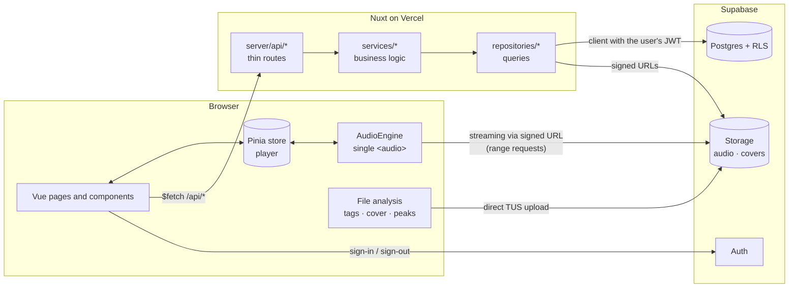
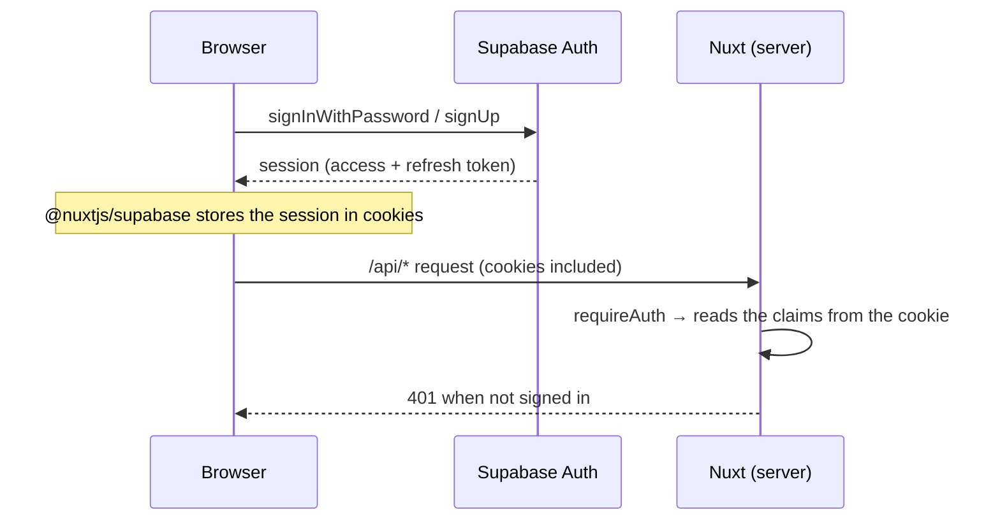
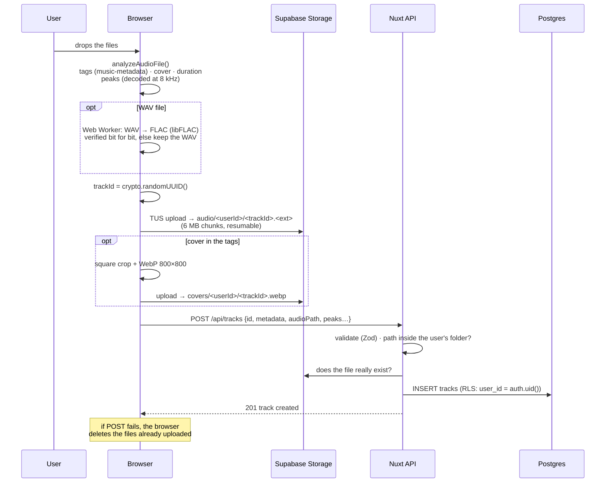
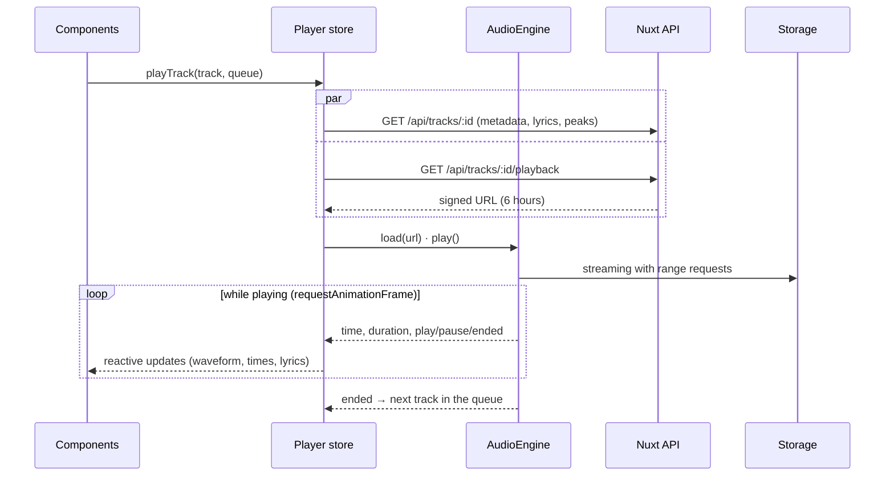
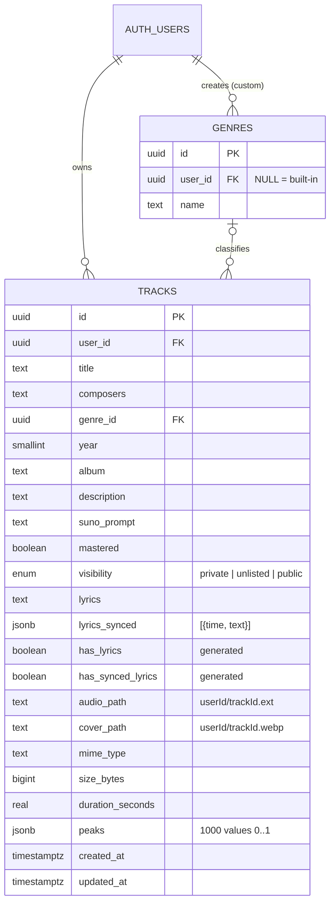

# ChronoPlayer

A personal music library in the browser: upload your tracks, play them with an interactive waveform, manage their metadata (composers, genre, Suno prompt, mastering status…) and sync the lyrics line by line to watch them scroll while you listen.

It works on desktop and smartphones and can be installed as a PWA.

---

## Contents

- [Features](#features)
- [Tech stack](#tech-stack)
- [Architecture](#architecture)
- [Project structure](#project-structure)
- [Data flows](#data-flows)
- [Lossless WAV → FLAC conversion](#lossless-wav--flac-conversion)
- [Data model and security](#data-model-and-security)
- [API](#api)
- [Local setup](#local-setup)
- [Environment variables](#environment-variables)
- [Scripts and Makefile](#scripts-and-makefile)
- [Testing](#testing)
- [Deployment (Supabase + Vercel)](#deployment-supabase--vercel)
- [Development conventions](#development-conventions)
- [Known limitations and next steps](#known-limitations-and-next-steps)
- [Troubleshooting](#troubleshooting)

---

## Features

| Area | What it does |
|---|---|
| **Accounts** | Sign-up, sign-in and sign-out with email and password. Each user only sees their own tracks. |
| **Library** | Track list with cover, composers, duration, genre, mastering status and visibility/lyrics indicators. Search, genre and mastering filters, sorting. Click a track's name to play it; click the name of the track already in the player to open the full-screen view. |
| **Upload** | Drop multiple files (MP3, WAV, FLAC, AAC/M4A, OGG/Opus, max 500 MB). Title, composers, album, year, genre, lyrics and cover are read from the tags. **WAV files are converted to FLAC losslessly**, with a bit-for-bit verification (see [Lossless WAV → FLAC conversion](#lossless-wav--flac-conversion)). Resumable upload with a progress bar. |
| **Player** | Always-visible bottom bar that survives page changes. Clickable and draggable waveform (scrubbing), elapsed and remaining time, play/pause, stop, previous/next, volume and mute. Controls also from the lock screen and media keys (Media Session). |
| **Expanded player** | Full-screen view with a large cover, waveform, controls and **synced lyrics**: the active line is highlighted, the text scrolls automatically, and clicking a line seeks there. |
| **Editor** | Title, composers, album, year, genre (built-in + custom ones created on the fly), description, Suno prompt, mastered yes/no, visibility (private / unlisted / public), cover (cropped and converted to WebP), lyrics with sections (`[Verse]`, `[Chorus]`). |
| **Lyrics sync** | "Tap to sync": while the track plays, press <kbd>Space</kbd> at the start of each line. Playback at 0.5× / 0.75× (pitch preserved), a zoomable detailed waveform with a **draggable marker per line**, replay of the selected line (<kbd>R</kbd>), ±0.05 s adjustments (<kbd>←</kbd> <kbd>→</kbd>), undo, section headers kept, **LRC** import and export. |
| **PWA** | Installable on phones and desktop, with icons and a manifest. |

**No AI.** The app uses no artificial-intelligence services, SDKs or models. The "Suno prompt" field is just a text field to note down the prompt used elsewhere.

---

## Tech stack

| Layer | Technology | Notes |
|---|---|---|
| Framework | **Nuxt 4.6** (Vue 3.5, Vite, Nitro) | Frontend and backend in one project |
| Language | **TypeScript** (strict) | Database types generated from the schema |
| UI | **Nuxt UI 4** + Tailwind CSS 4 | Accessible components (Reka UI), Lucide icons via Iconify |
| State | **Pinia** | Player store |
| Utilities | **VueUse** | Events, storage, etc. |
| Database, Auth, Storage | **Supabase** (Postgres 17) | With Row Level Security |
| Supabase integration | `@nuxtjs/supabase` | Cookie-based session, also usable on the server |
| Waveform | **wavesurfer.js 8** | Pre-computed peaks, no decoding during playback |
| Audio tags | **music-metadata 12** | Tag parsing in the browser |
| Upload | **tus-js-client** | Resumable upload (TUS protocol) straight to storage |
| WAV → FLAC | **libflacjs** (libFLAC 1.3.4, WebAssembly) + **hash-wasm** (MD5) | Reference FLAC encoder, run in a Web Worker |
| Validation | **Zod 4** | Same schemas for forms (client) and API (server) |
| PWA | `@vite-pwa/nuxt` | |
| Tests | **Vitest**, `@nuxt/test-utils`, **Playwright**, **pgTAP** | Unit, components, end-to-end, database |
| Quality | ESLint (`@nuxt/eslint`, stylistic), vue-tsc | |
| Deployment | **Vercel** (app) + **Supabase Cloud** (data) | |

---

## Architecture



Key principles:

1. **Files never go through Vercel.** Serverless functions accept requests of about 4.5 MB, while a FLAC weighs 30-50. The browser uploads files straight to Storage and plays them from signed URLs. The backend only handles lightweight data.
2. **The backend uses the user's token, never the service key.** Every query goes through Postgres RLS policies, so even a bug in server code cannot expose another user's data.
3. **Audio processing in the browser.** Tags, cover, duration and waveform peaks are computed before uploading, so the server never processes files.
4. **A single audio engine.** The `<audio>` element lives outside components, while the UI (bar, expanded view, lyrics editor) is a "view" over the same store. That is why music keeps playing across page changes.
5. **Layered backend.** `api` (HTTP) → `services` (logic, no Nuxt dependencies) → `repositories` (queries). Services are tested in isolation.

---

## Project structure

```
ChronoPlayer/
├── app/                          # Frontend (Nuxt 4: srcDir = app/)
│   ├── app.vue / error.vue       # Root and error page
│   ├── app.config.ts             # Theme colors (Nuxt UI)
│   ├── assets/css/main.css       # Tailwind + Nuxt UI
│   ├── components/
│   │   ├── AppHeader.vue, AppLogo.vue, ConfirmDialog.vue
│   │   ├── player/               # PlayerBar, PlayerExpanded, PlayerWaveform, PlayerControls, PlayerVolume
│   │   ├── lyrics/               # LyricsView (synced/plain), LyricsSyncEditor (tap to sync)
│   │   └── track/                # TrackList, TrackCover, TrackCoverPicker
│   ├── composables/              # useTrackUploader (upload queue), useGenres
│   ├── layouts/                  # default (header + player), auth (sign-in)
│   ├── lib/                      # Browser code without Vue: audio-engine, audio-analysis,
│   │   │                         #   resumable-upload, image, media-session
│   │   └── flac/                 # WAV parser, verified FLAC encoder, Web Worker
│   ├── pages/
│   │   ├── index.vue             # Library
│   │   ├── login.vue, confirm.vue
│   │   └── tracks/new.vue, tracks/[id]/edit.vue
│   ├── plugins/media-session.client.ts
│   ├── services/api.ts           # Typed API client
│   ├── stores/player.ts          # Pinia player store
│   └── utils/errors.ts
├── server/                       # Backend (Nitro)
│   ├── api/                      # HTTP routes: authenticate, validate, call a service
│   ├── services/                 # Business logic (tracks, genres)
│   ├── repositories/             # Postgres and Storage queries
│   ├── mappers/                  # DB rows ↔ domain types
│   └── utils/                    # auth (requireAuth), validation (Zod), errors
├── shared/                       # Code used by both client and server
│   ├── schemas/track.ts          # Zod schemas
│   ├── types/                    # Domain types + database.types.ts (generated)
│   └── utils/                    # lyrics (LRC), peaks, storage paths, audio formats, time
├── supabase/
│   ├── config.toml               # Local stack configuration
│   ├── migrations/               # Schema, RLS, storage (versioned)
│   ├── seed.sql                  # Demo user (local only)
│   └── tests/database/           # pgTAP tests
├── test/
│   ├── unit/                     # Vitest (Node)
│   ├── nuxt/                     # Vitest in the Nuxt environment (components)
│   └── e2e/                      # Playwright
├── scripts/                      # setup-env.mjs (.env), gen-types.mjs (DB types)
├── public/                       # Favicon and PWA icons
├── Makefile                      # Project commands
├── nuxt.config.ts · vitest.config.ts · playwright.config.ts · eslint.config.mjs
└── .github/workflows/ci.yml      # CI
```

---

## Data flows

### Authentication



- The `@nuxtjs/supabase` middleware redirects unauthenticated users to `/login` and saves the requested page in a cookie, to return there after signing in.
- `/login` and `/confirm` are rendered in the browser only. A form submitted before hydration would trigger a native GET submit, with the password in the URL.
- Email confirmation is disabled locally. In production the user receives a link that leads to `/confirm`.

### Uploading a track



- The client generates the track id, so the file path is known before uploading. The server still checks that the path is `<user id>/<track id>.*` and that the file exists.
- The **peaks** (1000 values between 0 and 1) are stored in the DB: the waveform shows up immediately without downloading and decoding the file again.
- The genre read from the tags is matched to an existing genre with the same name. Genres are never created automatically.

- WAV files are converted to FLAC before uploading, see the next section.

### Playback



- Every track change increments a *token*, and responses of superseded loads (fast double click) are ignored.
- The waveform (wavesurfer.js) receives the engine's `<audio>` element and the stored peaks. Clicking or dragging it moves the audio position directly.
- The **Media Session** (`plugins/media-session.client.ts`) exposes title, cover and controls to the operating system.

### Editing metadata and cover

1. `GET /api/tracks/:id` loads the detail, and the form uses the same Zod schemas as the server.
2. `PATCH /api/tracks/:id` sends only the changed fields. The server validates them, the mapper turns them into columns and RLS guarantees that the track belongs to the user.
3. **Cover**: the browser crops and converts the image, uploads it to `covers/<userId>/<trackId>.webp` (overwriting the previous one), then sends `PATCH { coverPath }`. Removing it (`coverPath: null`) makes the server delete the file too.
4. The player store receives the updated track (`syncTrack`), so title and lyrics also change in the bottom bar.

### Lyrics sync

- The **lyrics** (`lyrics`) are free text: lines in square brackets (`[Chorus]`) are section headers.
- **Synced lyrics** (`lyrics_synced`) are a JSON array `[{ "time": 12.34, "text": "…" }]` sorted by time, convertible to and from LRC (`shared/utils/lyrics.ts`). Section headers are kept as `{ "time": …, "text": "[Verse 1]", "section": true }`, so synced lyrics stay structured.
- The editor takes the rows from the lyrics (empty lines are skipped) and assigns the player's current time to the next lyric line still to be synced. Section headers are never stamped: each takes the time of the line right after it. "Reload from lyrics" rebuilds the rows while keeping the times of lines already synced.
- Syncing aids, all manual (no automatic alignment):
  - **Speed**: 0.5× / 0.75× / 1× with the pitch preserved; back to 1× when leaving the Sync tab. The player bar shows the speed when it is not 1×.
  - **Detailed waveform** (`LyricsSyncTimeline.vue`): unlike the player waveform (1000 stored peaks), it decodes the track itself for full detail, follows playback, zooms from 20 to 400 px/s and shows a numbered marker per synced line. Dragging a marker moves the start of its line.
  - **Selected line**: the last stamped line, or one clicked in the list or on the waveform. <kbd>R</kbd> replays it from 1 s before its start; <kbd>←</kbd> / <kbd>→</kbd> move it by 0.05 s.
- LRC import and export keep the sections: `[00:10.00] [Verse 1]`, or an untimed `[Verse 1]` line that is attached to the next timed line.
- During playback the active line is found with a binary search over the times (`findActiveLineIndex`, which never returns a header); the expanded player shows the headers as section titles.

### Deletion

`DELETE /api/tracks/:id`: the server deletes the row (RLS), then removes audio and cover from storage. The client drops the track from the queue and closes the player if it was playing.

### Visibility and sharing

| Value | Who can read it |
|---|---|
| `private` | Only the owner |
| `unlisted` | Anyone with the track id, through the `get_shared_track(id)` function |
| `public` | Anyone, even without signing in (table `select` policy) |

Storage policies allow reading the files of non-private tracks. The database is therefore already ready for a public sharing page (see [next steps](#known-limitations-and-next-steps)).

---

## Lossless WAV → FLAC conversion

WAV files are converted to FLAC in the browser before uploading. FLAC is a **lossless** format: it compresses the audio the way a ZIP file does, and decoding it gives back exactly the same samples as the original WAV. Savings depend on the music: typically 30-50% for quiet or acoustic material, less (around 20%) for loud, dense or noisy masters.

The conversion is never trusted blindly. A FLAC is only uploaded when **all** of these checks pass (`app/lib/flac/encoder.ts`):

1. **Samples read straight from the file.** The WAV is parsed byte by byte (`app/lib/flac/wav.ts`): no Web Audio decoding, no resampling, no float conversion.
2. **libFLAC verify mode.** The reference encoder decodes every frame while encoding and compares it with the input.
3. **Source MD5 = stream MD5.** The MD5 of the WAV audio bytes, computed independently of our parser, must equal the MD5 libFLAC stores in the FLAC header. This proves the encoder received exactly the samples of the file.
4. **Full decode.** The whole FLAC is decoded again with MD5 checking enabled, and every decoded sample is compared with the original one.

If anything fails or does not match, the **original WAV is uploaded unchanged**. The WAV is also kept as it is when FLAC cannot store it exactly:

| WAV | Result |
|---|---|
| 16-bit or 24-bit integer PCM (8 channels max) | converted to FLAC |
| 32-bit floating point | kept as WAV (FLAC only stores integer samples) |
| 32-bit integer | kept as WAV (not supported by the bundled libFLAC 1.3) |
| Compressed WAV encodings (ADPCM, μ-law…) | kept as WAV |
| FLAC not smaller than the WAV | kept as WAV |

Non-audio WAV chunks (markers, cue points, `LIST` info) are not carried over to the FLAC: titles and other metadata live in the database.

The conversion runs in a Web Worker (`app/lib/flac/flac.worker.ts`) so the interface stays responsive: a 100 MB 24-bit WAV is converted and verified in about 2 seconds on a desktop browser. The upload page shows the outcome for each file (`99.7 MB → 78.9 MB, lossless, verified bit for bit`, or the reason the WAV was kept).

---

## Data model and security



**Migrations** (`supabase/migrations/`):

| File | Content |
|---|---|
| `…_schema.sql` | Tables, constraints (lengths, year, paths inside the owner's folder), indexes, `updated_at` trigger, owner-change guard, built-in genres |
| `…_rls.sql` | RLS policies for `tracks` and `genres`, `get_shared_track` function |
| `…_storage.sql` | Private buckets `audio` (500 MB, `audio/*`) and `covers` (10 MB, images), storage policies |

**Security guarantees**, verified by the pgTAP tests:

- A user reads, updates and deletes only their own tracks and genres. Of other users' tracks, they only see public ones.
- Nobody can create tracks on behalf of someone else, or change the owner of a track.
- Files can only be uploaded into one's own folder (`<user_id>/…`) and only read when they are one's own or belong to non-private tracks.
- Buckets are private: files are only reachable through expiring signed URLs.
- The public key (`SUPABASE_KEY`) can live on the client: protection comes from the policies, not from keeping the key secret. The service key is not used by the app.

---

## API

Every route requires a valid session (cookie), otherwise it responds `401`. Validation errors: `400` with per-field `data.issues`.

| Method | Path | Description |
|---|---|---|
| `GET` | `/api/health` | Service status (public) |
| `GET` | `/api/tracks` | The user's library (summaries + signed cover URLs) |
| `POST` | `/api/tracks` | Registers a track already uploaded to storage → `201` |
| `GET` | `/api/tracks/:id` | Full detail (metadata, lyrics, peaks) |
| `PATCH` | `/api/tracks/:id` | Updates one or more metadata fields / the cover |
| `DELETE` | `/api/tracks/:id` | Deletes the track and its files → `204` |
| `GET` | `/api/tracks/:id/playback` | Signed streaming URL `{ url, expiresAt }` |
| `GET` | `/api/genres` | Built-in + custom genres |
| `POST` | `/api/genres` | Creates a custom genre (or returns the existing one with the same name) |

Response types live in `shared/types/track.ts`, request bodies in `shared/schemas/track.ts`.

---

## Local setup

### Prerequisites

| Tool | Version | Notes |
|---|---|---|
| Node.js | **24.11+** (or 22.21+) | `.nvmrc` pins 24. Older versions make Nuxt print a warning. |
| pnpm | 12 | `npm i -g pnpm` or `corepack enable` |
| Docker Desktop | recent | For local Supabase (Postgres, Auth, Storage) |
| GNU Make | optional | Ships with Git Bash on Windows. Otherwise use the `pnpm` scripts. |

The Supabase CLI is a dev dependency of the project, so there is no need to install it globally.

pnpm keeps its package store inside the project, in `.pnpm-store/` (configured in `pnpm-workspace.yaml`, git-ignored). Files in `node_modules` are hard links to the store, so the two folders share the same disk space even though Explorer counts it twice.

### Starting everything with one command

After `pnpm install` (once), a single command starts the whole stack. It works from PowerShell, Git Bash or any terminal. **Open Docker Desktop first**: the commands stop with an error when Docker is not running.

| Command | What it starts | App URL |
|---|---|---|
| `pnpm local` | Supabase → `.env` → Nuxt **dev server** with hot reload | http://localhost:3000 |
| `pnpm docker` | Supabase → the app **built and run in a container** (production build) | http://localhost:8080 |
| `pnpm stop` | Stops the app container and Supabase. **Data is kept** for the next start. | |

`make local`, `make docker` and `make stop` do the same. With `pnpm local`, press <kbd>Ctrl</kbd>+<kbd>C</kbd> to stop the app; Supabase keeps running until `pnpm stop`. Container logs: `make docker-logs` (or `docker compose logs -f app`).

Sign in with the demo user **`demo@chronoplayer.local` / `chronoplayer`** or create a new one.

How the Docker mode works: Supabase always runs in the containers managed by the Supabase CLI. `pnpm docker` builds the app image (`Dockerfile`, multi-stage: only the Nitro output ships) and starts it with `compose.yaml`. Inside a container `127.0.0.1` is the container itself, so the app reaches Supabase through `host.docker.internal`. Docker Desktop maps that name on the host too, so the browser and the server use the same URL. The script writes it to `.env.docker` (git-ignored).

### Step by step

The one-command scripts wrap these steps:

```bash
make setup     # pnpm install → supabase start → .env → DB types
make dev       # http://localhost:3000
```

Without Make:

```bash
pnpm install
pnpm db:start          # the first time it pulls the Docker images (a few minutes)
pnpm env:local         # writes SUPABASE_URL and SUPABASE_KEY to .env
pnpm db:types
pnpm dev
```

Useful local services:

| Service | URL |
|---|---|
| App | http://localhost:3000 |
| Supabase Studio (DB, users, files) | http://127.0.0.1:54323 |
| Test emails (Mailpit) | http://127.0.0.1:54324 |
| Supabase API | http://127.0.0.1:54321 |

---

## Environment variables

| Variable | Required | Description |
|---|---|---|
| `SUPABASE_URL` | yes | Supabase project URL (local: `http://127.0.0.1:54321`) |
| `SUPABASE_KEY` | yes | **Public** key (publishable / anon) |

Locally they are generated with `make env`. On Vercel they are set in the project's *Environment Variables*. See `.env.example`.

---

## Scripts and Makefile

### `package.json` scripts

| Script | What it does |
|---|---|
| `pnpm local` | **Start everything** for development (Supabase, `.env`, Nuxt); Docker Desktop must be open |
| `pnpm docker` | **Start everything** in Docker (Supabase + app container on :8080) |
| `pnpm stop` | Stop the app container and Supabase (data is kept) |
| `pnpm dev` | Development server |
| `pnpm build` / `pnpm preview` | Production build / local preview |
| `pnpm lint` / `pnpm lint:fix` | ESLint (formatting included) |
| `pnpm typecheck` | vue-tsc over app, server and shared |
| `pnpm test` | All Vitest tests (unit + components) |
| `pnpm test:unit` / `pnpm test:nuxt` | Unit only / components only |
| `pnpm test:watch` | Vitest in watch mode |
| `pnpm test:coverage` | Coverage report (`coverage/`) |
| `pnpm test:db` | pgTAP database tests |
| `pnpm test:e2e` / `pnpm test:e2e:ui` | Playwright (headless / UI mode) |
| `pnpm check` | lint + typecheck + test |
| `pnpm db:start` / `db:stop` / `db:status` | Manage the local Supabase stack |
| `pnpm db:reset` | Recreate the local DB from migrations and seed |
| `pnpm db:migration <name>` | New empty migration |
| `pnpm db:lint` | Static analysis of the schema |
| `pnpm db:types` | Regenerate `shared/types/database.types.ts` (the file is only written on success) |
| `pnpm db:push` | Apply migrations to the linked remote project |
| `pnpm env:local` | Generate `.env` from the local stack |
| `pnpm generate:pwa-assets` | Regenerate the PWA icons from `public/favicon.svg` |

### Makefile

`make help` prints the full list. The main commands:

| Command | What it does |
|---|---|
| `make local` / `make docker` / `make stop` | Start or stop the whole stack (see [Local setup](#local-setup)) |
| `make docker-logs` | Follow the app container logs |
| `make setup` | Complete first run |
| `make dev` | Development |
| `make db-start` / `db-stop` / `db-reset` | Local database |
| `make db-migration name=add_playlists` | New migration |
| `make db-types` | Regenerate the types |
| `make db-test` / `make db-lint` | Database tests and analysis |
| `make db-link ref=<project-ref>` + `make db-push` | Migrations to Supabase Cloud |
| `make check` | Quick checks before a commit |
| `make ci` | Everything the CI runs (e2e included) |
| `make clean` / `make clean-all` | Cleanup |

---

## Testing

| Level | Tool | Where | What it covers |
|---|---|---|---|
| Unit | Vitest (Node) | `test/unit/` | LRC parser and serializer, active-line lookup, peaks, paths, formats, Zod schemas, mappers, **backend services** (with mocked repositories), **player store** (with a fake audio engine: queue, previous/next, race conditions, errors), **WAV → FLAC**: real libFLAC round trips (8/16/24-bit, mono/stereo, full-scale extremes) checked with a second, independent FLAC decoder, MD5 against Node's crypto, and detection of a corrupted stream |
| Components | Vitest + `@nuxt/test-utils` | `test/nuxt/` | `LyricsView` (active line, seek, sections), `TrackCover` |
| Database | pgTAP (`supabase test db`) | `supabase/tests/database/` | RLS policies across two users and an anonymous visitor, constraints, generated columns, sharing, storage policies |
| End-to-end | Playwright | `test/e2e/` | Sign-in, sign-up, sign-out, protected pages, real upload of a 24-bit WAV (the file **downloaded back from storage** must be a FLAC decoding to exactly the original samples), floating-point WAV kept unchanged, playback, editing, cover, LRC import, expanded player, deletion |

```bash
make test        # unit + components (seconds)
make db-test     # database (requires db-start)
make test-e2e    # end-to-end: production build on :3100 + local Supabase
E2E_DEV=1 pnpm test:e2e   # e2e against the dev server (:3000)
```

E2E tests generate WAV files on the fly and register throwaway users (`e2e-…@chronoplayer.test`). A `make db-reset` brings the local DB back to its initial state.

The **CI** (`.github/workflows/ci.yml`) runs lint, typecheck and the Vitest tests. It then starts Supabase in the runner and runs the database analysis, pgTAP tests and e2e. If anything fails, it uploads the Playwright report.

---

## Deployment (Supabase + Vercel)

### 1. Supabase Cloud

1. Create a project on [supabase.com](https://supabase.com).
2. Link it and apply the migrations:
   ```bash
   pnpm exec supabase login
   make db-link ref=<project-ref>   # the ref is in the dashboard URL
   make db-push
   ```
   `seed.sql` (demo user) is **not** applied in production.
3. **Authentication → URL Configuration**:
   - *Site URL*: `https://<your-domain>`
   - *Redirect URLs*: `https://<your-domain>/confirm`
4. **Storage → Settings**: check the *Global file size limit*. On the free plan the maximum is 50 MB per file. The 500 MB limit of the `audio` bucket only applies when the plan allows it.
5. Copy the *Project URL* and the *publishable key* (Settings → API).

### 2. Vercel

1. Import the repository: the Nuxt preset is detected automatically.
2. *Environment Variables*: `SUPABASE_URL`, `SUPABASE_KEY`.
3. *Settings → General → Node.js Version*: 24.x.
4. pnpm: the version is pinned in `packageManager`. If Vercel does not pick it up, add the `ENABLE_EXPERIMENTAL_COREPACK=1` variable.
5. Deploy. Check `https://<your-domain>/api/health`.

For later migrations: `make db-migration name=…` → write the SQL → `make db-reset` and `make db-test` locally → `make db-push` → deploy the app.

---

## Development conventions

- **Language**: everything in the repository is in English (code, comments, docs, UI text, commit messages).
- **Style**: ESLint with stylistic rules (no Prettier). `make lint-fix` fixes things automatically.
- **Components**: Nuxt prefixes the component name with its folder (without repeating it). `components/track/CoverPicker.vue` would be used as `<TrackCoverPicker>`, not `<CoverPicker>`. For clarity, files already carry the full name (`track/TrackCoverPicker.vue`), and the typecheck flags unknown components.
- **New table or column**: migration → RLS policies in the same migration → pgTAP tests → `make db-types` → mapper → repository → service → route → client in `app/services/api.ts`.
- **New endpoint**: a route in `server/api/` should only call `requireAuth`, validate with `readValidated` / `requireUuidParam` and call a service. Logic belongs in the service, which is tested without Nuxt.
- **Shared code**: anything needed by both client and server goes in `shared/` (pure code only, no browser or Node APIs).
- **Never** use the Supabase service key in the app: the server-side client must act with the user's token.

---

## Known limitations and next steps

- **Public sharing page** (`/t/[id]`) with a social preview: DB and storage are ready (`get_shared_track`, policies). The server-rendered page is still missing.
- **Playlists and an editable queue** (reordering, "play next").
- **Manual cover cropping**: cropping is currently automatic (centered).
- **Cover signed URLs**: they change every time the library loads, so the browser cannot cache them. Options: a public bucket for covers of public tracks, or longer-lived, memoized URLs.
- **Library pagination**: everything is loaded at once today, which is fine up to a few hundred tracks.
- **PWA offline mode** (downloading tracks to listen without a connection).
- **Writing tags into files** (e.g. ID3 for MP3s) on download/export.

---

## Troubleshooting

| Problem | Solution |
|---|---|
| `Current version of Node.js … is unsupported` | Upgrade Node to 24.11+ (`nvm install 24`) |
| `supabase start` fails | Docker Desktop must be running. Run `pnpm db:stop`, then try again. |
| `pnpm local` / `pnpm docker`: "Docker is not running" | Open Docker Desktop and wait until the engine is running. If it is stuck while starting, use **Restart** from its tray menu |
| `pnpm docker`: the app cannot reach Supabase | Docker Desktop must map `host.docker.internal` on the host (Settings → General → "Add the *.docker.internal names to the host's /etc/hosts file", on by default) |
| Always sent back to `/login` | `.env` missing or stale: `make env`, then restart `make dev` |
| `Audio format not supported` during playback | The browser does not support that codec (e.g. some OGG files on older Safari). The file stays saved. |
| Large uploads fail in production | Check the storage *Global file size limit* (50 MB on the free plan) |
| Outdated database TypeScript types | `make db-types` after every migration |
| First page load in `make dev` is very slow | Expected: Vite compiles dependencies on the first request. Later loads are fast. |
| `make` not found on Windows | Use Git Bash, or the equivalent `pnpm …` commands above |
