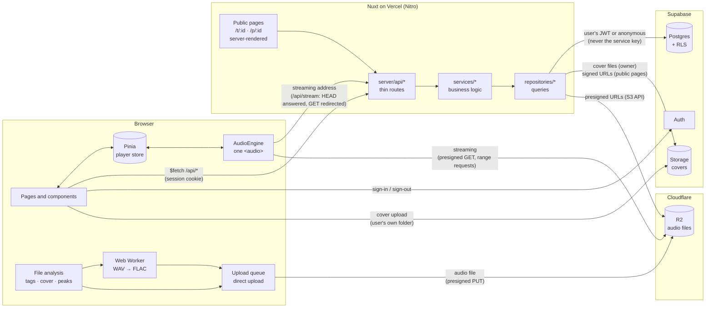

# 5. Architecture

## 5.1 Overview

## 5.2 Key principles

1. **Large files never go through the app server.** Vercel functions accept requests of about 4.5 MB, while a FLAC weighs 30-50 MB. The browser uploads audio straight to R2 and covers straight to Supabase Storage, and streams audio from presigned URLs (the app's streaming address only redirects to them, [7.7](07-data-flows.md#77-expired-streaming-urls)). The server only handles small JSON payloads, signs URLs and serves the owner's covers (small WebP images, so the browser can cache them: [7.2](07-data-flows.md#72-loading-the-library)); storage credentials never leave it.
2. **The server acts as the user, never as an admin.** Every query carries the user's own JWT (or none, for visitors of public pages), so Postgres Row Level Security decides what each request can read or write. Even a bug in server code cannot expose another user's data. The Supabase service key is not used anywhere.
3. **Audio is processed in the browser.** Tags, cover, duration, waveform peaks and the WAV → FLAC conversion all happen before the upload, so the server never decodes audio.
4. **One audio engine.** A single `<audio>` element lives outside components. The player bar, the full-screen view, the lyrics editor and the public pages are views over the same store, which is why music keeps playing across page changes.
5. **A layered backend.** `api` (HTTP: authenticate, validate) → `services` (rules, no Nuxt dependency, unit-tested with mocks) → `repositories` (queries) → `mappers` (rows ↔ domain types).
6. **Shared contracts.** Domain types (`shared/types`) and Zod schemas (`shared/schemas`) are used by both sides: the client forms validate exactly like the API.
7. **Private by default.** Buckets are private, tracks and playlists start private, other people only ever reach an item by its link, and a private item answers exactly like a missing one (`404`).

## 5.3 Where everything runs

**Two pieces, not three.** The app is:

1. **Supabase**: Postgres, Auth and Storage (covers; locally also the audio, through its S3 endpoint). Locally it always runs in Docker, in the containers the Supabase CLI manages.
2. **Nuxt**: the pages **and** the API. `server/api/**` is not a separate server: Nitro serves it from the same process as the pages, so "the backend code" and "the frontend" start, stop and reload together.

So developing means **Supabase in Docker, Nuxt on your computer**: `pnpm local` (or `make local`) starts the first, then runs the second in the terminal with hot reload, for pages, components and `server/api` alike. `pnpm docker` puts the same Nuxt app, built for production, in a container instead: it is there to try that build, and it keeps the code of its last `pnpm docker` until rebuilt (`pnpm local` warns when it is still running; `make docker-stop` stops it alone).

| Piece | `pnpm local` (develop) | `pnpm docker` (try the build) | Production |
|---|---|---|---|
| Nuxt: pages + API (`server/api`) | Dev server on the host, :3100, hot reload | Compose service `app` (project `chronovault`), :8180, rebuilt by each `pnpm docker` | Vercel |
| Postgres, Auth, Storage (covers) | Supabase CLI containers (:54321) | Same Supabase containers, reached via `host.docker.internal` | Supabase Cloud |
| Audio files | Supabase's local S3 endpoint, bucket `audio` | Same | Cloudflare R2, bucket `chronovault-audio` |
| Config file | `.env` | `.env.docker` | Vercel environment variables |

The local database and the production database are **completely separate**: accounts, tracks and playlists created locally never appear online, and vice versa.

## 5.4 Rendering modes

| Routes | Rendering | Why |
|---|---|---|
| `/`, `/tracks/**`, `/playlists`, `/playlists/**`, `/versions`, `/versions/**`, `/stats` | Client only (`ssr: false`) | Personal pages that use browser APIs (Web Audio, files, workers); nothing to gain from SSR |
| `/login`, `/confirm`, `/reset-password` | Client only | A form submitted before hydration would send the password in the URL (native GET submit) |
| `/t/:id`, `/p/:id` | **Server-rendered** | Link previews (chat apps, social networks) read the HTML: title, description and image must be in it |
| `/api/**` | API, `Cache-Control: no-store` | Responses are personal or contain signed URLs |
| `/cast-test` | Server-rendered (no rule), signed-in only | Temporary Cast diagnostic page, linked from nowhere: to be removed once casting works ([16](16-troubleshooting.md#16-troubleshooting)) |
| `/api/covers/**` | API, `Cache-Control: private, max-age=31536000, immutable` | Cover images at versioned addresses: each device downloads a cover once ([7.2](07-data-flows.md#72-loading-the-library)) |

The `@nuxtjs/supabase` route middleware sends signed-out visitors to `/login`, except on `/t/*`, `/p/*` and `/reset-password` (its session comes from the email's link).

Server-rendered pages hand the Pinia state they built to the browser, which applies it to the stores. The player's volume, shuffle and repeat are read from this browser's `localStorage` instead, so they are `skipHydrate` refs: opening `/t/…` and then the library keeps the settings saved on the device.

## 5.5 Reusable building blocks

Logic that more than one page, component or service needs lives in one place. Check here before writing a new helper.

**Shared (`shared/utils`, client and server, auto-imported):**

| Helper | File | What it does |
|---|---|---|
| `pluralize`, `capitalize`, `truncate`, `joinParts`, `foldCase`, `hasText` | `text.ts` | "3 tracks", "Version" from "version", cut texts with "…", "Album · 2026 · Genre" lines, case-insensitive keys (search, genre names, the metadata import's titles; accents compared in one Unicode form), blank-value checks (tag writers, download toast) |
| `clamp` | `numbers.ts` | Volume, speed, seek position, crop geometry |
| `moveItem` | `arrays.ts` | Move inside an ordered list without mutating it (play queue, playlist order) |
| `syncRowsFromLines`, `roundToCentiseconds`, `hasLyrics` | `lyrics.ts` | Sync editor rows from stored or imported lines, LRC precision, "has lyrics to show" (public pages) |
| `WAV_MIME_TYPES` | `audio-files.ts` | The names WAV goes by: FLAC conversion on upload, tagging on download |
| `patchSchemaOf` | `shared/schemas/track.ts` | PATCH body of an item with a cover: tracks and playlists |
| `formatTime`, `formatRemaining`, `formatAge`, `formatBytes` | `time.ts` | "3:07", "-1:12", "2 days ago", "38.4 MB": durations, positions, ages and sizes on screen |
| `buildAudioPath`, `buildCoverPath`, `buildPlaylistCoverPath`, `isAudioPath`, `isSafeStorageKey` | `storage-paths.ts` | The exact storage paths of a track's audio and cover and of a playlist's cover, as the database requires them ([8.5](08-data-model-and-security.md#85-security-guarantees)) |

**Backend (`server/`):**

| Helper | File | What it does |
|---|---|---|
| `playbackSource`, `expiresIn` | `services/playback.ts` | Streaming address (`/api/stream`, see [7.7](07-data-flows.md#77-expired-streaming-urls)) with its expiry, for the owner's library and the public pages |
| `removeCoverFiles` | `services/playback.ts` | Best-effort deletion of cover files, skipping items without one |
| `trackCoverUrlOf`, `playlistCoverUrlOf` | `mappers/cover-urls.ts` | Cacheable cover address of a row, or null (mappers, statistics) |
| `toSharedTrackContent` | `mappers/track.ts` | Shareable fields of a track: the public track page and each track of a public playlist |
| `byPosition` | `repositories/playlists.repository.ts` | Playlist order of embedded and RPC rows |
| `badRequest`, `notFound`, `playlistNotFound`, `conflict` (+ `isConflict`), `toHttpError` | `utils/errors.ts` | Consistent HTTP errors |
| `requireAuth`, `visitorClient` | `utils/auth.ts` | The signed-in user and their database client (`401` otherwise) · an anonymous client for the public routes |
| `requireUuidParam`, `readValidated`, `readValidatedQuery` | `utils/validation.ts` | A route's id, body and query checked (against a Zod schema) before the service sees them (`400`) |
| `readAllPages` | `repositories/pages.ts` | Every row of a list that grows with the user's data, past PostgREST's 1000 ([14.2](14-conventions.md#142-code-conventions)) |

**Frontend (`app/`):**

| Building block | Kind | Used by |
|---|---|---|
| `useAsyncTask` | composable | Every button that calls the API: a `running` flag for the spinner, failures as an error toast |
| `usePlaylistList(purpose)` | composable | The cached list of playlists or of groups of versions, kept in sync by the pages that change them (`remember`, `forget`) |
| `<PlaylistEditor>`, `<PlaylistGrid>` | components | Owner page and card grid of both purposes: Playlists and Versions |
| `readLibrary` | `app/lib/library-request.ts` | The library list (`GET /api/tracks`): the library page and the saved-queue restore share the read made while the app opens (until the first page is shown), later only a read in progress |
| `useEditForm` | composable | Track editor, playlist details: form state, "unsaved changes" and the question before leaving the page (the app's LeaveDialog, through `useLeaveConfirm`: Stay, Leave without saving, Save and leave) or the app (reload, closed tab: the browser's own) |
| `useCoverEditor` + `useCoverStorage` | composables | Cover pickers (crop → WebP → Storage → `PATCH coverPath`), and the covers found in tags during an upload |
| `useSortableList` + `<DragHandle>` | composable + component | Drag and drop of the playlist page and the "Up next" panel |
| `useSharedItem`, `useShareMeta` | composables | Public pages: SSR load with `404`/`500`, link-preview tags |
| `<SharePlayer>`, `<ShareUnavailable>`, `<ShareLinkBox>` | components | Public pages' player and "not available" state; the "Sharing" box of the editors |
| `useQueueActions().menuItems`, `usePlaylists().addToPlaylistMenu` | composables | "Play next / Add to queue" and "Add to playlist" menu entries (library, selection bar, playlist page) |
| `useSignedInRedirect` | composable | Sign-in and confirmation pages: enter the app once a session exists |
| `usePageTitle` | composable | Every page's browser tab title: "Library · Chronovault" (the name from `shared/brand.ts`) |
| `<AppLogo>`, `<AppMark>` | components | The logo (mark + name, optionally the tagline) in the headers and on the sign-in page; the mark alone, drawn from the shared geometry |
| `APP_NAME`, `FALLBACK_COVER`, `BRAND_COLORS`, `MARK_STROKES` | `shared/brand.ts` | The brand for code: the name wherever it is written, the fallback cover, the colours of the manifest and icons, the mark's geometry ([5.6](#56-brand-and-theme)) |
| `player.displayTrack` | store getter | What the bar, the full-screen view and the queue show: during a change of track (and after a failed load) the track being moved to, never the one before it |
| `VISIBILITY_INFO`, `VISIBILITY_ITEMS` | `app/utils/visibility.ts` | Labels, explanations and icons of the three visibilities |
| `PLAYLIST_PURPOSE_INFO`, `playlistPath` | `app/utils/playlist-purpose.ts` | Section, address and wording of each playlist purpose ("playlist"/"track", "group"/"version") |
| `copyText` | `app/utils/clipboard.ts` | Clipboard with a fallback (share links, LRC export) |
| `saveFile` | `app/lib/save-file.ts` | Hands a file built in the browser to the user (downloads, LRC export) |
| `haptic`, `HAPTIC` | `app/lib/haptics.ts` | A short vibration as touch feedback, silent where unsupported |
| `concatBytes`, `asciiAt` | `app/lib/bytes.ts` | WAV parser, FLAC encoder, tag writers, streamed downloads |
| `waveformColors` | `app/lib/theme.ts` | Colors of every waveform, from the current theme (the played part in spectral blue) |
| `<IconButton>` | component | Every button that shows only an icon: one `label` is both its `aria-label` and its tooltip; all other props go to `UButton` (menu triggers included) |
| `<ThemeButton>` | component | The light/dark switch with its tooltip (header, public pages) |

## 5.6 Brand and theme

The app wears the identity of Chronovault, the Suno project it was made for, taken from its artwork (`brand/chronovault.jpg`): a night sky, a gold ornate portal with a galaxy at its core, spectral blue figures and a guitar whose strings glow.

**One source.** `shared/brand.ts` holds the name (`APP_NAME`, in its two halves for the logo), the tagline, the colours code needs as values, the fallback cover's addresses and the mark's geometry. Every place that names or draws the app reads it: the logo, page titles (`usePageTitle`), link previews (`useShareMeta`), the lock-screen card, the vendor string of downloaded FLAC files, `nuxt.config.ts` (title, theme colour, PWA manifest) and the image generator. Renaming the app means changing it there.

**The mark** is drawn on a 100×100 grid as a list of strokes, each painted by role: `ring` (gold), `wave` (spectral blue), `halo` (the background colour, drawn wider under each wave so the ring is cut where a string crosses it and the two never merge). Two variants:

| Variant | Drawing | Where |
|---|---|---|
| `full` | the portal (a ring with twelve ticks, like a dial) crossed by three guitar strings, the middle one vibrating | the logo in the headers and on the sign-in page, the PWA icons, the Apple and Android home-screen icons |
| `small` | the same portal crossed by a single sound wave, growing towards the centre | the browser tab (`favicon.svg`, `favicon.ico`), where three strings would blur together at 16 px |

In the app (`<AppMark>`) the strokes take the theme's colours (`--ui-primary`, `--ui-secondary`, `--ui-bg`), and the galaxy glow inside the portal shows on the dark theme only. `<AppLogo>` adds the name in **Cinzel** capitals, "CHRONO" in the text colour and "VAULT" in gold; on phones the app header shows the mark alone, and the share pages and the sign-in page add the tagline from `sm` up.

**Colours.** `app/assets/css/main.css` defines three scales in the Tailwind way (50 to 950), made in OKLCH from the artwork's colours, and `app/app.config.ts` gives them to Nuxt UI:

| Nuxt UI role | Scale | Brand value | Used for |
|---|---|---|---|
| `primary` | `gold` | `#d6a84e` (400) | buttons, links, the current track, the logo's ring and "VAULT", charts |
| `secondary` | `spectral` | `#66d6ff` (400) | the played part of every waveform, the progress lines of the phones' bar and the share pages' mini player, the logo's strings |
| `neutral` | `night` | `#0b1024` (900) | backgrounds, surfaces, borders and text: the dark theme's background is the night of the artwork |

Nuxt UI would use step 500 in the light theme and 400 in the dark one. Gold 500 on white reads at only 3.2:1, so `main.css` takes **700 in the light theme** (6.2:1 for gold, 4.7:1 for spectral blue: above the 4.5:1 text needs) and the brand colours themselves, **400, in the dark theme** (8.6:1 and 11:1 on the night). The status colours had the same problem in the light theme: at 500 they read on white at 1.9:1 (warning, yellow), 2.2:1 (success, green), 3.8:1 (info, blue) and 3.8:1 (error, red), so warning alerts were yellow on pale yellow, the "mastered" tick pale green, error lines faint. Each takes the first step whose text still reads above 4.5:1 on the 10% tint of a subtle alert or badge, the palest background it sits on: **warning and success 800, info and error 700** (5.4:1 to 6.1:1 there; info 600 would sit right on 4.5:1). The dark theme keeps Nuxt UI's 400 for all four, 6.5:1 to 12:1 on the night. `theme-contrast.spec.ts` measures every one of these colours, in both themes, as the browser resolves them. `BRAND_COLORS` in `shared/brand.ts` repeats the brand values for the manifest and the icons; a unit test (`test/unit/config/brand.test.ts`) checks the two copies agree.

**Images** (`public/`, committed, made by `pnpm generate:brand` with `scripts/generate-brand.mjs`):

| File | What | Drawn from |
|---|---|---|
| `favicon.svg`, `favicon.ico` (16, 32, 48 px) | the browser tab | `small` mark on a rounded night tile |
| `pwa-64x64.png`, `pwa-192x192.png`, `pwa-512x512.png` | the installed app | `full` mark on a rounded tile, transparent corners |
| `maskable-icon-512x512.png` | Android's adaptive icon | `full` mark at 78% on a full square: the system may crop to a circle, and only the central 80% is sure to stay |
| `apple-touch-icon-180x180.png` | iPhone and iPad home screen | `full` mark at 88% on a full square (iOS rounds the corners) |
| `cover-fallback.webp` | the cover of tracks and playlists without one, in the app and on the lock screen; precached by the service worker | the artwork, central square, 800×800 |
| `cover-fallback.jpg` | the same in link previews (not every chat app reads WebP) | the same |

After changing the mark, the colours or the artwork: `pnpm generate:brand`, then commit the files. The brand test fails while the favicon still draws an old mark, or when a file the head or the manifest names is missing.

---

← [4. Tech stack](04-tech-stack.md) · [Contents](../README.md#documentation) · [6. Project structure](06-project-structure.md) →
