# 7. Data flows

Every flow below names the files involved, so it can be followed in the code.

## 7.1 Authentication and route protection

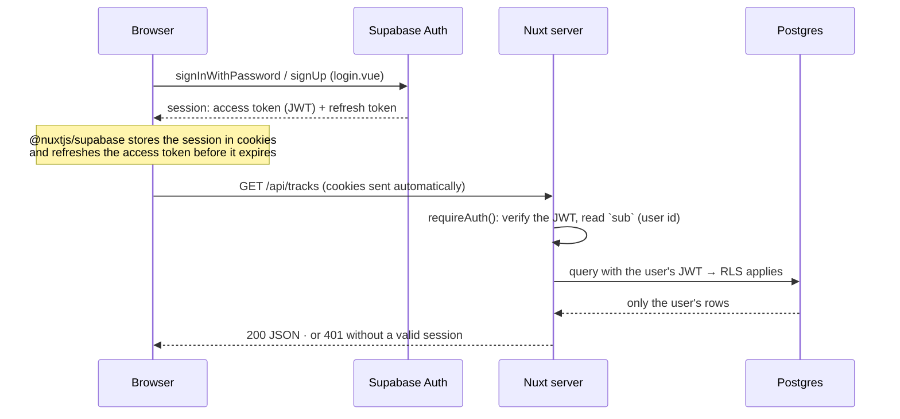

- **Route protection.** The `@nuxtjs/supabase` middleware sends signed-out users to `/login` and remembers the requested page in a cookie; after sign-in, `login.vue` and `confirm.vue` go back there (`useSignedInRedirect`, built on `useSupabaseCookieRedirect`; a saved path that matches no page, such as a stale `/sw.js`, falls back to the library). Public pages (`/t/*`, `/p/*`) are excluded, and so is `/reset-password`, which gets its session from the email's link.
- **Sign-up.** Locally, email confirmation is off: the account is usable immediately. In production Supabase sends a confirmation link pointing to `/confirm`, where the session is created and the user is redirected. For a personal deployment you can disable sign-ups altogether ([13.4](13-deployment.md#134-after-the-first-deploy)).
- **Forgotten password.** "Forgot password?" (`login.vue`) calls `resetPasswordForEmail` with `/reset-password` as the address to come back to; Supabase answers the same whether the address has an account or not. The email (`supabase/templates/recovery.html`) links to that page with a one-time `token_hash`, which `reset-password.vue` verifies (`verifyOtp`, type `recovery`): that signs the user in, in whichever browser opened the link, and the token leaves the address bar. The new password is saved with `updateUser`, then the library opens. Supabase's default email would go through its own `/verify` and come back with a `code` that only the browser that asked can exchange; the page still accepts it (the Supabase client exchanges it at start-up). A used, expired or missing token shows "This link no longer works" with a way to ask for a new one.
- **Sign-out** (`AppHeader.vue`): stops the player (no audio for a signed-out user), clears the session, goes to `/login`.
- **Server side** (`server/utils/auth.ts`): `requireAuth(event)` returns `{ userId, db }`, where `db` is a Supabase client carrying the user's JWT. Public routes use `visitorClient(event)`: the visitor's session if any, otherwise the anonymous role.

## 7.2 Loading the library

1. `pages/index.vue` calls `GET /api/tracks` once (`readLibrary`, `lib/library-request.ts`). On opening the app with a saved queue, its restore asks for the library too: the read made while the app opens is shared until the first page is on screen, even once answered, so the library is read once for both (it was read twice). Sharing only a read in progress depended on timing: the restore asks first, and its read could answer before the page's code had arrived. After that, a read in progress is still shared, and once answered the next call reads again.
2. `tracks.service.listTracks` reads the summary columns only (no lyrics, peaks or long texts), **every track**: PostgREST answers at most 1000 rows per request and cuts the rest silently, so the list is read in pages of 1000 (`readAllPages`, `server/repositories/pages.ts`), ordered by date then id so pages never overlap. The same goes for every list that grows with the user's data (playlists, genres, the Statistics labels, and the file paths the storage clean-up compares with the storage: a path missing there would make its file look orphaned). Each cover gets a **stable, versioned address**, `/api/covers/tracks/<id>?v=<version>` (`mappers/cover-urls.ts`): nothing is signed.
3. The page filters (search, genre, mastering, version) and sorts **in the browser**: no request per keystroke.
4. Genres come from `GET /api/genres` (built-in + the user's custom ones), loaded once and shared by every page (`useGenres`).
5. Playing a track passes the **currently filtered list** as the queue: "next" follows what is on screen.
6. **Virtual scroll** (`TrackList.vue`, `@tanstack/vue-virtual`'s window virtualizer): the whole library is in memory, but only the rows on screen, plus 10 beyond each edge, are in the page. The list keeps the height of all its rows, each drawn row placed at its position (estimated at the root size, then measured), so the page scrolls, and comes back to where it was after a track's page, as if every row were there. Search, filters, sorting, "select all" and the queue still work on the whole list (steps 3 and 5). Screen readers hear each row's place in the whole list (`aria-posinset` / `aria-setsize`); the browser's own find (Ctrl+F) sees only the drawn rows, the library's search box sees them all. The data grows by about 0.4 KB per track: comfortable up to several thousand.

**Covers are cached by the browser.** A signed Storage URL carries a new token every time, so the browser would see a new image and download every cover again on each visit. The library therefore uses app addresses instead:

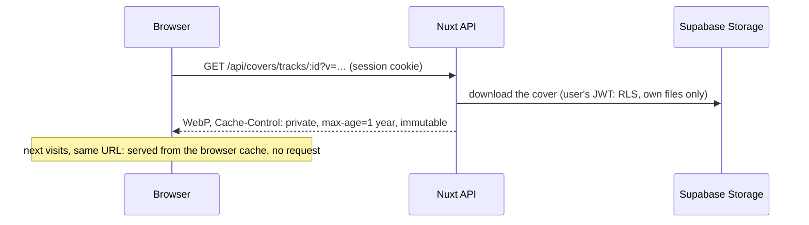

- **Versioned:** `v` is the track's (or playlist's) `updated_at` in base 36. A new cover changes `updated_at`, hence the address, so the browser fetches the new image; the server ignores `v`.
- **Owner only:** the routes require the session and read the cover with the user's JWT; another user's track answers `404`. `private` keeps the image out of shared caches and CDNs.
- The same addresses serve playlist custom covers (`/api/covers/playlists/<id>?v=…`), the mosaics, the player, the queue, the Media Session artwork and the tags of downloaded files.
- **Public pages** (`/t/`, `/p/`) keep signed URLs: their visitors have no session these routes could check ([7.14](#714-sharing)).

## 7.3 Uploading a track

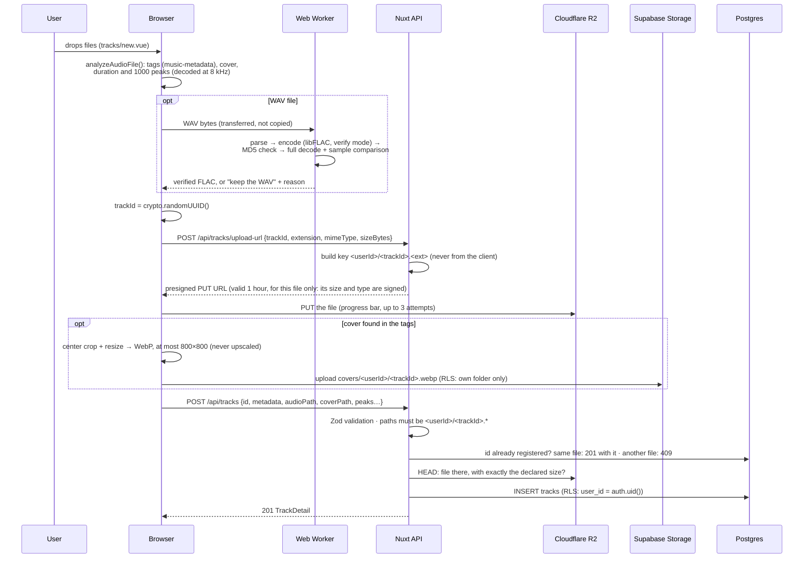

- **One file at a time** (`useTrackUploader`): parallel uploads would compete for bandwidth and memory, and the conversion is CPU-heavy. Files dropped while the queue runs are picked up by the same loop. **Leaving during an upload asks first**: closing the tab (the browser's own question) and going to another page of the app alike, there in the app's own dialog (`useLeaveConfirm`) with Stay and Leave only, uploads having nothing to save first. Once left, the file in progress finishes but the ones still queued are not uploaded: nothing would show their progress or their errors, and coming back to the page starts a new list (its queue would have run beside the old one).
- **Statuses** shown per file: queued → analyzing → converting (WAV only) → uploading → saving → done, or error with the reason.
- **Tags → metadata.** Title (or the file name), composers (composer tags, else the artist), album, year (1000-9999 only), lyrics, synced lyrics (an ID3 SYLT frame, or LRC text in a lyrics field: `lyricsFromTags` in `audio-analysis.ts`), cover. The genre tag is matched to an existing genre with the same name; genres are never created automatically (and only a built-in genre or one of your own can be set on a track, [8.5](08-data-model-and-security.md#85-security-guarantees)). The duration is the decoded one, else the tags', kept only when plausible (0 to 30 days, `plausibleDuration`).
- **Failure handling:**

| Failure | What happens |
|---|---|
| Unsupported format or > 500 MB | Shown as failed immediately, nothing uploaded |
| Tags unreadable | Defaults (file name as title), upload continues |
| Audio not decodable in the browser | No waveform peaks (a flat placeholder is drawn), upload continues |
| FLAC conversion impossible or not verified | The original WAV is uploaded, with the reason shown |
| Network error or 5xx during the PUT | Retried twice, with growing delays |
| A file of another size or type than declared sent to the address | Refused by the storage (`403`): the address's signature holds the declared size and type, so it stores that file only, never retried |
| Cover conversion/upload fails | The track is saved without a cover |
| Stored file missing or of a different size | The server deletes it and refuses the track (400) |
| An audio path other than `<userId>/<trackId>.<ext>`, the extension 1 to 10 lower-case letters and digits (`isAudioPath`, the database's own rule) | `400` before anything is touched (an extension holding a control character used to reach the storage client, which refused the key with a `500`) |
| A duration past 30 days (`MAX_DURATION_SECONDS`), or one a `real` cannot hold | `400` (the schema; `22003` from the database too): `1e39` used to be a `500` that left the audio behind. The browser leaves out an implausible duration read from the tags (`plausibleDuration`), so a broken tag never gets a track refused |
| A cover path other than `<userId>/<trackId>.webp` | `400` before anything is touched (it used to pass the server, fail the database's rule and take the audio with it) |
| The database refuses the track (`4xx`) | The server deletes the audio, the browser deletes the cover |
| The insert fails with no answer to trust (`500`: a timeout, a dropped connection) | The audio is **kept**: the row may have been committed, and deleting its file would leave a track that cannot play. If it was not, the file is an orphan, shown in the Storage dialog ([7.12](#712-storage-clean-up)) |
| The registration is sent twice (a retry after a lost response, a double submit, two tabs) | The repeat gets `201` with the track already registered, and its file is never deleted: the server looks for the id first, and when two identical requests race, the one that loses the insert (unique violation, `409`) leaves the file to the winner |
| An upload address is asked for an id already registered | `409`: a registered track's file can never be overwritten |
| Browser closed between the upload and the registration | The file stays in R2 unused: an orphan, removed from the Storage dialog ([7.12](#712-storage-clean-up)) |

## 7.4 Lossless WAV → FLAC conversion

WAV files are converted to FLAC in the browser before uploading. FLAC is **lossless**: it compresses audio the way a ZIP file compresses text, and decoding it gives back exactly the samples of the original WAV. Savings depend on the music: typically 30-50% for quiet or acoustic material, around 20% for loud, dense or noisy masters.

The result is never trusted blindly. A FLAC is uploaded only when **all** these checks pass (`app/lib/flac/encoder.ts`):

1. **Samples read straight from the file.** The WAV is parsed byte by byte (`app/lib/flac/wav.ts`): no Web Audio decoding, no resampling, no float conversion.
2. **libFLAC verify mode.** The reference encoder decodes every frame while encoding and compares it with the input.
3. **Source MD5 = stream MD5.** The MD5 of the WAV audio bytes, computed independently of our parser, must equal the MD5 libFLAC writes in the FLAC header (STREAMINFO): the encoder received exactly the samples of the file.
4. **Full decode.** The whole FLAC is decoded again with MD5 checking on, and every decoded sample is compared with the original.

If anything fails, the **original WAV is uploaded unchanged**. It is also kept when FLAC cannot store it exactly:

| WAV | Result |
|---|---|
| 8, 16 or 24-bit integer PCM, up to 8 channels | Converted to FLAC |
| 32-bit floating point | Kept as WAV (FLAC stores integer samples only) |
| 32-bit integer | Kept as WAV (not supported by the bundled libFLAC 1.3) |
| Compressed encodings (ADPCM, μ-law…), RF64 | Kept as WAV |
| FLAC not smaller than the WAV | Kept as WAV |

**A SEEKTABLE in every FLAC** (`app/lib/flac/seektable.ts`): the index "this sample is at this byte", one point every 10 seconds, inserted right after STREAMINFO once the file is encoded and before the full decode checks it. libFLAC writes none when driven through write callbacks, and without it a browser jumping into a part of the track not downloaded yet searched the file with range requests, one after the other: eleven for the middle of a 3-minute track, about 1.3 s on the local stack and more on R2. With it, one request (about 0.1 s locally). The table is found by reading the finished file's frame headers (sync code, CRC-8, frame number in sequence, and the frames must add up to the stream's length, or the file stays as encoded); the audio frames are untouched, and the tags written into downloads keep it. Files stored before it have none (seeking into them stays slow): upload them again to get one.

Non-audio WAV chunks (markers, cue points, `LIST` info) are not carried over: titles and other metadata live in the database. The worker (`flac.worker.ts`) keeps the page responsive — a 100 MB 24-bit WAV is converted and verified in about 2 seconds on a desktop browser — and a watchdog keeps the WAV if the worker stays silent for 30 seconds. The upload list shows the outcome (`FLAC · lossless, verified bit for bit · 99.7 MB → 78.9 MB (−21%)`, or why the WAV was kept).

## 7.5 Playback

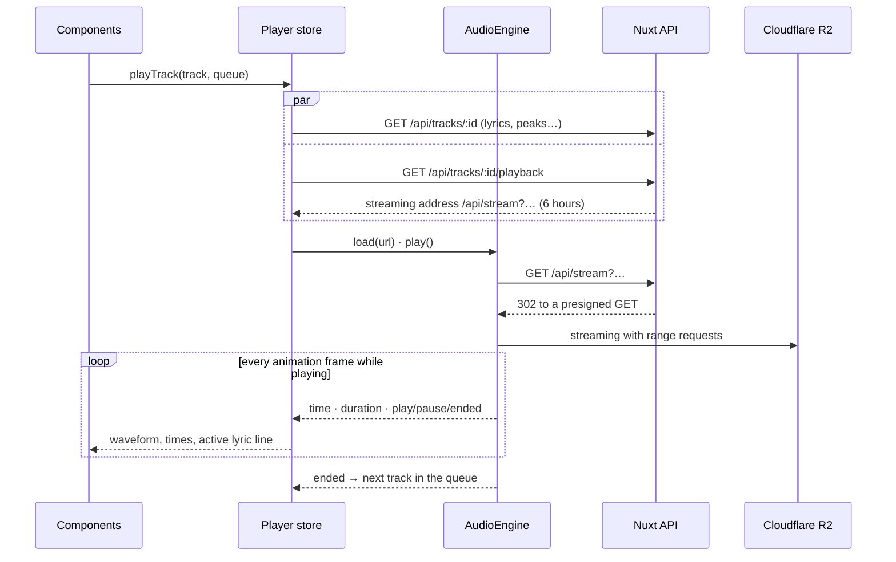

- **The engine** (`app/lib/audio-engine.ts`) wraps one `<audio>` element created on first use, outside Vue. While playing it reports the time on every animation frame (`timeupdate` alone fires only ~4 times a second, too coarse for lyrics). **With the page hidden** (screen off, another tab or app) the browser draws no frames while the audio plays on, so `timeupdate` takes over: otherwise the position would freeze until the page shows again, and plays would go uncounted and "previous" from the lock screen would misjudge the position. Tracks keep following one another with the screen off, in the app and on the share pages alike.
- **The store** (`app/stores/player.ts`) holds the queue, the current track, status, time, volume, shuffle and repeat (saved in `localStorage`), speed and the full-screen flag. Components see one store with one flat API, but the state lives in separate parts in `app/lib/player/`, which the store puts together:
  - `queue.ts`, **the queue and its order**: the tracks, `index`, shuffle and the original order, the Up next edits. No audio: it only decides the order;
  - `playback.ts`, **the loaded track**: the reactive mirror of the engine (status, time, duration, volume, speed) and its commands, with the expired-URL recovery ([7.7](#77-expired-streaming-urls)). It knows nothing of the queue: the store tells it what to load and hears from it when a track ends. Every load increments a token: responses of superseded loads (fast double clicks) are ignored. It also asks for the next track ahead (`prefetch`, below);
  - `sources.ts` (below) and `settings.ts` (volume, shuffle and repeat remembered on the device);
  - the store itself keeps the rules that need several parts at once: which track comes next (next, previous, repeat), shuffle and repeat, the public pages' players, the full-screen and Up next flags. A remote engine for the TV page ([15.2](15-limitations-and-next-steps.md#152-next-steps)) would sit beside `playback.ts` without touching the queue.
- **Track sources.** The store fetches data and URLs from a *source*: the library (signed-in API), a shared track or a shared playlist (public API). The same player, waveform and lyrics components therefore work on the public pages.
- **Waveform** (`PlayerWaveform.vue`): wavesurfer.js draws the stored peaks on the engine's own `<audio>` element; clicking, dragging or ←/→ seek directly. Nothing is downloaded twice.
- **The player bar** (`PlayerBar.vue`), always on screen while something is loaded:
  - on phones, cover and title, play/pause and next, and a thin progress line on top (the rest is in the full-screen view, including the ✕ that closes the player: the bar has no room for it);
  - from `md` (768 px), three columns. Left: cover and title, truncated. Middle, on two rows: the elapsed time, the waveform and the remaining time, then the controls (shuffle, stop, previous, play, next, repeat), in the same order as the full-screen view and with the progress on top as on phones. Right: the volume, then Cast, Up next, expand and close. Between `md` and `lg` the volume is one more icon button that opens a popover with a vertical slider (with a mouse; on a touch screen it only mutes, see below), and the Expand button is left out (Cast is always there on touch screens, and a fifth icon squeezed the title again; tapping the title, or swiping it up, opens the full-screen view anyway); from `lg` (1024 px) the slider sits inline;
  - from `lg` the columns grow from a zero basis at a 1:2:1 ratio (`flex-1` / `flex-[2]` / `flex-1`; the right one never narrower than its buttons), so the waveform keeps a real width at every size and the title truncates first. On tablets that ratio left the title about 100 px wide, so there the right column only takes its buttons' width (`flex-none`) and the middle one is `flex-[1.5]`, still wide enough for the six controls. Before, everything but the waveform had a fixed width, and at 768–1279 px the waveform shrank to nothing. The base font size is 125 % (106.25 % below 640 px), so rem sizes change while breakpoints stay in pixels: always check the bar at 768, 1024 and 1280 px after changing it;
  - the bar is 5.5 rem tall on phones and 6.5 rem from `md` (`--player-bar-height` in `main.css`, which also leaves that room under the page content): the two rows, a 32 px waveform and 2 rem buttons, keep some air around them;
  - the controls' tooltips open above them, so over the waveform; they close as soon as the pointer leaves the button (`disable-hoverable-content` in `IconButton`), so they never catch a click meant for the waveform.
- **"Previous"** restarts the current track when more than 3 seconds have played, otherwise goes back one track.
- **Repeat** (library playback only): *all* starts the queue again after its last track (and "Previous" on the first track goes to the last); *one* starts the track that ended again from 0:00 without reloading it (an expired URL is replaced first), while "Next" and "Previous" still change track. *Off* stops at the end of the queue.
- **Commands while a track loads** (`autoplayWanted` in `lib/player/playback.ts`): the player bar's play button is disabled while a track loads, but play, pause and play/pause from anywhere else (a share page's big Play button, the keyboard, the lock screen) are kept and applied once the track is in: a share page cues its first track paused on open, and a Play pressed before it was ready used to do nothing. Clicking a track compares it with **the queue's track**, not the loaded one: while B loads, A is still loaded, and a click back on A now goes back to A instead of being taken for "pause the current track".
- **The next track, asked for ahead** (`prefetch` in `lib/player/playback.ts`, `comingNext` in the store). Loading a track takes two requests, its data and its streaming address: a pause of several hundred ms between tracks on the deployed app (more with a cold function), and, with the screen off, a `play()` that came only after a network wait, which some browsers (Safari on iPhone above all) refuse in the background. So the store works out which track will start by itself when the current one ends: the next in the queue; at the end of a looping queue, the first of the new round; none with *repeat one*, at the end of a queue that stops, or for a shuffled new round (drawn only then). 20 seconds before the end (half-way through a track shorter than 40) and only while playing, it asks for that track's data and address. When the track ends, `load()` finds them ready and starts the next one in the very same call, no network wait in between. One track at most is kept ready: if the next one changes (Up next edited, shuffle), the new one is asked for; still on its way at the end, it is waited for; failed, or with an address about to expire, it is asked for again as before. A skip with the Next button uses it too. Measured end to end with 500 ms of simulated API latency (`track-change.spec.ts`): the gap went from about 555 ms to about 40 ms, which is the new file starting. A short gap remains: true gapless playback would need two audio elements taking turns, which casting, the waveform and the lock screen (all tied to the one element) do not allow.
- **Keyboard shortcuts** (`lib/keyboard-shortcuts.ts`: the keys and the rules; `plugins/keyboard-shortcuts.client.ts`: one `keydown` listener on the window, driving the store as the buttons do). <kbd>Space</kbd> play/pause; <kbd>←</kbd> / <kbd>→</kbd> five seconds (held down, they keep seeking); <kbd>Shift</kbd>+<kbd>←</kbd> / <kbd>→</kbd> previous (or the start of the track, as the button) / next; <kbd>M</kbd> mute; <kbd>F</kbd> opens and closes the full-screen view; <kbd>?</kbd> opens their list (`KeyboardShortcutsDialog`, mounted by both layouts, also in the account menu). Letters follow the keyboard's layout (the key they produce) and ignore the case. They act only with something in the player (on an empty player Space scrolls the page as usual), and never take a key that already means something:
  - any combination with <kbd>Ctrl</kbd>, <kbd>Cmd</kbd> or <kbd>Alt</kbd> (the browser's and the system's);
  - text fields (typing), and any dialog but the player's full-screen view (marked `data-player-shortcuts`);
  - <kbd>Space</kbd> on what it activates by itself (buttons, links, checkboxes, menu items): it would act twice. It does work on the waveform, a slider, so a click on it to seek and then Space to pause works;
  - the arrows on what moves with them (sliders, the waveform's own five-second steps included, menus, lists, tabs, radio groups); letters inside menus and lists, which find their items by typing;
  - a component that uses the keyboard as a whole **claims** it while in use (`useKeyboardClaim`): the lyrics sync editor, whose <kbd>Space</kbd> stamps a line. Its listener and the shortcuts' are both on the window, and the order of listeners cannot be relied on, hence a claim rather than `preventDefault`.
  The buttons that do the same announce their shortcut to screen readers (`aria-keyshortcuts`, from the same table).
- **Volume** (`PlayerVolume.vue`, `pageControlsVolume` in `lib/audio-engine.ts`). On a server-rendered share page the level saved on the device shows only once the page is mounted: the server renders full volume (it cannot know the saved one), and Vue does not fix attributes that differ at hydration, so the speaker icon used to show 100% while the audio played at the saved level. A slider only with a mouse or trackpad (a fine primary pointer) on a browser that lets pages set the volume. On touch screens, phones and tablets alike, the hardware buttons own the volume: a page level would multiply with theirs (at 30% here, even their maximum sounds quiet, with no visible reason), and, remembered on the device, it could stay low for good behind buttons that already do everything. So there the player offers **mute alone** and plays at **full level**, whatever was saved. The primary pointer decides, not the screen width: a laptop with a touch screen, used with its trackpad, keeps the slider. On iPhone and iPad the page could not set the volume anyway (`canSetVolume`, which reads back a probe's level).
- **Media Session** (`plugins/media-session.client.ts`, `lib/media-session.ts`): title, artist, album and cover on the lock screen and in the media notification, with play/pause/next/previous/seek controls. A track without a cover shows the Chronovault artwork (`public/cover-fallback.webp`, the app's fallback cover), and a missing artist or album reads "Chronovault", so the card always shows the track and whose music it is; artwork addresses are made absolute, since the system fetches them outside the page.
- **Screen off.** Playback goes on with the screen off or the app in the background, like a music app: the player is an `<audio>` element with an active Media Session, which Android browsers keep playing (they only pause *video* in the background, which is why YouTube stops), and nothing in the app pauses on `visibilitychange`; the next track starts by itself (`ended` still fires). What shows while the screen is **off** is up to the phone, not the app: Android draws nothing on a switched-off screen, except the music info some phones put on the always-on display (e.g. Samsung: Settings → Lock screen → Always On Display → Show music information). Pressing the power button shows the media card on the lock screen, unless Settings → Notifications (or Sound) → "Show media on lock screen" is off.
- **Cast** (`useRemotePlayback`, `PlayerCastButton.vue`): the browser's Remote Playback API on the app's single `<audio>` element. The browser finds the devices on the Wi-Fi network (Chromecast, Google TV, TVs and speakers with Chromecast built in, from Chrome-based browsers on Android; AirPlay devices from Safari on iPhone and iPad), shows its own picker and hands the audio address to the device, which fetches and plays it (signed URLs last 6 hours; Chromecast plays FLAC, MP3 and WAV). The element stays the controller, so the app's buttons, the queue and the lock-screen controls act on the device. The address cast is the app's streaming address, not a presigned storage URL ([7.7](#77-expired-streaming-urls)): it answers a HEAD request, which a presigned GET refuses. It was made because Chrome closed its picker at once ("NotAllowedError: The prompt was dismissed", in about 10 ms, in a Chrome tab and in the installed app alike), on the guess that a HEAD check was the cause; it did not change that refusal on Chrome for Android, which sent no HEAD at all. **Casting does not work yet from Chrome on Android:** the Remote Playback API never sees the Chromecast built-in TV that Chrome's own "Cast…" menu lists. The temporary page `/cast-test` (signed in, linked from nowhere, with `app/lib/google-cast.ts` and `public/cast-test.wav`) compares the element variants and tries the **Google Cast Web Sender SDK**, the route of that menu ([16](16-troubleshooting.md#16-troubleshooting)); it goes once casting works. The button is in the player bar from tablet width and in the full-screen view's top bar (phones). On touch screens it is **always there**, as in phone music apps: a tap opens the browser's picker, which searches the network then. With a mouse it only appears when the browser reports a device, or cannot tell until asked, as on video sites (most desktops have nothing to cast to). While casting it turns the primary colour, and pressing it again stops or moves the cast. A tap that finds nothing says "No devices found" (same Wi-Fi?); a refusal says "Casting is not available here", points to Chrome (Android) or Safari (iPhone, iPad), and adds **the browser's own answer** (error name, message and how fast it came, e.g. `NotSupportedError: … (12 ms)`): casting cannot be tried from a test browser, so on a real phone that text is the clue to why it failed. That covers Firefox (no API) and Chromium browsers without Google's casting service, such as **Opera on Android**: they refuse with the same error as a picker closed by the user (`NotAllowedError`), but at once, without showing anything, so a refusal under 300 ms is taken for "cannot cast" rather than "cancelled". TVs without Chromecast or AirPlay cannot be reached (Android's screen mirroring works there). The browser looks for devices in the background (`watchAvailability`) until the element stops being followed: a watch it confirms only after that (the full-screen view opened and closed at once) is cancelled as soon as it is confirmed, where it used to go on searching. **Bluetooth** speakers and headphones need nothing: Android routes all audio to them (pair in Settings → Bluetooth, or pick the output from the media notification).
- **Touch gestures** (touch events only, so a mouse never triggers them; VueUse `useSwipe` underneath):
  - **player bar** (`useTrackSwipe`): on the track area (cover and title), swipe left for the next track, right for "Previous" (same rule as the button: restart after 3 s), up to open the full-screen view. Cover and title follow the finger sideways and fade, then trigger past 80 px (or on a quick flick) or spring back; towards a next track that does not exist they follow stiffly and do nothing. The area has `touch-action: none`, so the browser neither scrolls nor navigates from it, and a plain tap still opens the full-screen view;
  - **full-screen view** (`useSwipeToDismiss`): pulled down from the top of its content it follows the finger, with the dimmed page showing behind (the modal panel is transparent and the view paints its own background), and closes past 120 px or on a flick. It never starts while the content is scrolled down, and never on what drags by itself (waveform, volume slider, lyrics: `data-swipe-ignore`). `overscroll-y-contain` keeps the browser's pull-to-refresh out of it;
  - the full-screen view's grid has an explicit single column on phones (`grid-cols-1`): without it a long title (which only truncates inside a column of fixed width) widened the column and pushed the view off the right edge.
- **Focus when the full-screen view opens:** the modal moves the focus inside, by default onto its first button, "Collapse player", whose tooltip then opened by itself (tooltips open on focus) and covered the cover. `PlayerExpanded` handles the modal's `openAutoFocus` and focuses the view's own root instead (`tabindex="-1"`): still inside the dialog for keyboards and screen readers, on no button.
- **Android back button** (`useCloseOnBack`): the full-screen view, Up next, the LRC dialog and the app's dialogs (confirmations, cover crop, new playlist, storage; not the keyboard-shortcuts list) each hold a browser `CloseWatcher` while open, so the back button or gesture closes the newest one instead of leaving the page or the installed app. Nothing is pushed into the history, so links followed from an open panel (e.g. "Edit track") and the router behave as before. Locked dialogs (deleting, saving) refuse and stay armed for the next press. On a desktop keyboard Esc is a close request too, but Nuxt UI already closes its topmost layer on Esc (which may be a menu above the panel), so a close request right after an Esc keydown is left to Nuxt UI. Chromium browsers only (Chrome, Opera, Edge, Samsung Internet); elsewhere nothing changes.

### Which phone and tablet browsers can cast

As of October 2026. ✅ documented, ❓ to try on a device, ❌ cannot. Having the Remote Playback API is not enough: the browser must also be able to reach the device (Opera has the API but no Chromecast support for pages). The ✅ rows have not been tried on a real device yet either: replace a ❓ or confirm a ✅ when one is.

| Android | Casts the app (to Chromecast / Google TV) | Notes |
|---|---|---|
| **Chrome** | ❓ | The API and Google's casting service, and it finds a Chromecast built-in TV from its own "Cast…" menu. Since October 2026 the Cast button is refused, in a tab and in the installed app alike ("NotAllowedError: The prompt was dismissed", ~10 ms), also with the app's streaming address ([7.7](#77-expired-streaming-urls)): the Remote Playback API sees no device. The Google Cast SDK is being tried on `/cast-test`, with the TCL Google TV |
| **Samsung Internet** | ❓ | Has the API since 6.2; it seems to cast through Android's system casting rather than Google's service, so whether a page reaches a Chromecast is unknown |
| **Brave** | ❓ | Chromecast reportedly on by default on Android (older sources) |
| **Edge, Vivaldi** | ❓ | Chromium-based, but casting is documented only for their desktop versions |
| **Opera** | ❌ | Casts only from its own video player, not from pages: the Cast button says "Casting is not available here" |
| **Firefox** | ❌ | No Remote Playback API |

| iPhone, iPad | Casts the app (to AirPlay: Apple TV, AirPlay TVs) | Notes |
|---|---|---|
| **Safari**, and the app added to the Home Screen from it | ✅ | The API since iOS 13.4, AirPlay only |
| **Chrome, Firefox, Edge… on iOS** | ❓ | They all run on Safari's engine (WebKit), so AirPlay may work; not documented |
| **Any browser, to a Chromecast** | ❌ | Google does not support casting from iOS browsers; only a TV app of our own would ([15.2](15-limitations-and-next-steps.md#152-next-steps), the TV page) |

In practice: **Chrome** on Android is the one to try for a Chromecast or Google TV (see its row), **Safari** on iPhone and iPad for AirPlay. Sources: [caniuse: Remote playback](https://caniuse.com/wf-remote-playback), [MDN: Remote Playback API](https://developer.mozilla.org/en-US/docs/Web/API/Remote_Playback_API), [Google: Cast for web](https://developers.google.com/cast/docs/web_sender), [Android Police: Opera's casting](https://www.androidpolice.com/2021/04/30/opera-for-android-finally-gets-casting-support-but-probably-not-the-way-you-want-it/), [Brave: Media Router on Android](https://github.com/brave/brave-browser/issues/13933).

## 7.6 Editable queue

The queue lives in the player store (`app/stores/player.ts`, its queue part in `app/lib/player/queue.ts`): the tracks already played, the current one (`index`) and the upcoming ones. Playing a track from a list makes that list the queue; from then on it can be edited.

| Action | Where | Effect |
|---|---|---|
| **Play next** | Track menu (library, playlist page); "Play next" in the Up next panel | Puts the track right after the current one. A track already in the queue is moved there instead of duplicated |
| **Add to queue** | Track menu | Appends the track. One already coming up stays where it is ("already in the queue"); one already played is moved to the end |
| **Reorder** | Up next panel: drag handle, or Move up/down | Changes the order of the upcoming tracks |
| **Remove** · **Clear** | Up next panel | Drops one upcoming track · all of them (playback stops after the current track; with repeat *all* it starts again from the first track of the queue) |
| **Play now** | Up next panel: click a track | Jumps to it; the tracks skipped become "previous" |
| **Shuffle** | Player bar (from 768 px wide), full-screen view | On: the upcoming tracks are shuffled (the current one and the history stay put). Off: they go back to the original order, carrying on from the current track |

- **Long queues draw a hundred rows at a time**: playing from the library queues the whole filtered list, and thousands of rows took seconds to draw on a phone (and to redraw at each change of the queue). The panel shows the first hundred upcoming tracks and a **Show more** button ("N more up next") for the next hundred; moves, removals and drag keep their real queue positions (the last row drawn can still move down). The heading counts every upcoming track, drawn or not. Not a virtual list: SortableJS moves the rows' DOM nodes itself.
- A track appears **at most once** in the queue, and only upcoming tracks can be edited: the current track and the history stay put, and `index` always points at the current track.
- When nothing from the library is playing, "Play next" and "Add to queue" simply start the track. A toast says what happened (`plays next`, `added to the queue`, `already playing`…).
- "Next", the end of a track and the lock-screen controls all follow the edited order.
- **Shuffle** reorders the queue itself (pure rules in `lib/queue-order.ts`), so Up next always shows the real play order. The store keeps the original order (`originalOrder`, track ids) to put it back: turning shuffle off continues from the current track in the original order, wrapping around, and drops manual moves made while shuffled. The original order is kept after shuffle is turned off too, so with repeat *all* every new round plays the list in that order (tracks added later at the end). With shuffle on, playing a track from a list puts it first and the rest of the list after it, shuffled (the playlist's *Play* button starts from a random track); "Add to queue" lands at a random place among the upcoming tracks, "Play next" still right after the current one; with repeat *all* every new round is reshuffled, never starting with the track that just ended.
- The panel (`PlayerQueue.vue` + `PlayerQueueList.vue`) mirrors the store: a drag moves the DOM through SortableJS, then the store receives the move, so the panel and the player never disagree.
- Queue editing applies to library playback only; the public pages have their own fixed order.
- **The queue survives reloads** on the same device (`lib/queue-storage.ts`, `plugins/queue-persistence.client.ts`): it is saved in the browser whenever it changes, every 5 seconds of playback and when the page is hidden. Opening the app again brings back the same queue and track, **paused at the same position**. Matching the saved ids with the tracks that still exist uses the library page's own read when both ask at once (`readLibrary`).
  - Only track ids are saved (format 2 adds `originalTrackIds`, the order before the first shuffle, once the queue has been shuffled; format 1 is still read as a queue without shuffle): on restore they are matched against the current library, so deleted tracks drop out (if the current one is gone, the next one is loaded from the start) and covers get their current addresses.
  - The page the queue was started from (`from`, the store's `queueFrom`: `playlist:<id>`) is saved too, so after a reload a playlist's page still knows its queue: "Play all" resumes it instead of starting over. Queues saved without it are read as library queues.
  - The saved queue belongs to one user: another account on the same browser never sees it.
  - Closing the player (×) or signing out forgets it. Public pages neither restore nor touch it.
  - It is per device: the queue on your phone and on your computer are separate.

## 7.7 Expired streaming URLs

**The streaming address.** The playback routes (`/api/tracks/:id/playback` and the two public ones) hand out the app's own address of the file, `/api/stream?k=<storage key>&e=<expiry>&s=<signature>` (`AudioStorage.streamUrl`, `server/api/stream.ts`), not a presigned storage URL:

- **HEAD** is answered by the app: `200` with the file's type, size and `Accept-Ranges`, read from the storage with a HEAD the server signs. A presigned GET URL refuses any other method (`403`); the HEAD answer was added for casting, on the guess that Chrome checks the address before offering a device, which did not turn out to be the cause (7.5);
- **GET** gets a `302` to a presigned GET of the file, valid as long as the address: the audio, range requests included, still comes straight from the storage, never through the app's server;
- **the signature** is an HMAC-SHA-256 of the key and the expiry, with a key derived from the storage secret (`chronovault-stream:` + the secret: nothing more to configure). A cast device has no session, so the address itself carries the permission; an altered key or expiry, a forged signature or an expired address get `403`, without telling whether the file exists (an incomplete address gets `400`, another method than GET or HEAD `405`). Answers carry `Access-Control-Allow-Origin: *` (a cast device's player runs on another origin) and `Cache-Control: no-store`.

The cost is one small function call per load or seek of a track (the redirect), instead of none.

Streaming addresses last 6 hours, and a paused track can sit for longer. The store recovers transparently:

1. **Before resuming or seeking**, if the URL expires within a minute, a fresh one is fetched and loaded at the same position. A newer reload supersedes an older one (`recoveryRound`): after a seek and a quick Play, the seek's late answer used to load its address after the Play's and leave the track paused; now it applies nothing, and the Play's reload resumes at the position sought.
2. **If storage refuses a URL anyway** (an error while playing or buffering), the source is reloaded once at the current position, then playback resumes.
3. Only if that also fails is an error shown in the player bar. Pressing play again retries from scratch.

The playback speed survives reloads (`defaultPlaybackRate`), and the waveform follows since it is bound to the same element.

## 7.8 Editing a track

1. `tracks/[id]/edit.vue` loads `GET /api/tracks/:id`. The form validates with the same Zod schema as the server (`trackMetadataSchema`).
2. **Save** sends `PATCH /api/tracks/:id`. The mapper turns only the fields present into columns (`undefined` = unchanged, `null` = cleared); RLS guarantees the track is the user's. Leaving with unsaved changes asks first (`useEditForm`, shared with the playlist's details dialog): for another page of the app, in the app's own dialog (`LeaveDialog`, opened by `useLeaveConfirm` as a Nuxt UI overlay; the router waits for the answer) with **Stay**, **Leave without saving** and **Save and leave**, which runs the same checks and save as Save and leaves only once saved (an invalid field keeps the page, with the error shown; it used to be the browser's grey box with OK and Cancel, and no way to save on the way out); and for a reload, a closed tab or the installed app closed, where the browser asks its own question (`beforeunload`), so an accidental pull-to-refresh on a phone no longer wipes, say, twenty minutes of syncing. **An edit made while a save is on its way is kept**: the form's fields are disabled during a save, but the Sync tab's keys are not, and a line stamped meanwhile used to vanish when the server's copy replaced the whole form and marked it clean. The form now remembers what it sent (`snapshot()`) and takes the server's values back only into the fields left alone since (`reset(values, sent)`); a field changed meanwhile keeps its value and stays unsaved, so Save and the leave-page question still see it.
3. **Genre:** typing a new name and choosing "Create" calls `POST /api/genres`, which returns an existing genre with the same name (built-in or custom, case-insensitive) instead of creating a duplicate.
4. **Cover:** a picked image opens the **crop editor** (`CoverCropDialog.vue`, see below); the browser then cuts the chosen square and converts it, uploads it to `covers/<userId>/<trackId>.webp` (overwriting the old one), then sends `PATCH { coverPath }` (`useCoverEditor`, shared with the playlist page). Removing it (`coverPath: null`) makes the server delete the file.
5. The updated track is pushed to the player (`syncTrack`), so the bar, the queue and the full-screen view show the new title, cover, lyrics and description at once.

**The crop editor** (`CoverCropDialog.vue`, used for track and playlist covers):

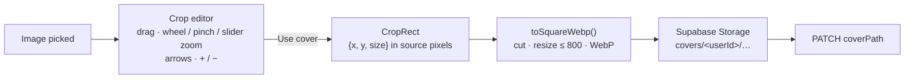

- The frame shows exactly what the cover will be, with a rule-of-thirds grid. It starts on the centered square (what automatic cropping picks), so "Use cover" right away keeps the old behaviour.
- The state is screen-independent (`CropView`: zoom 1-5 and the square's center in source pixels, `app/lib/image.ts`), always clamped so the square never leaves the image: no empty borders.
- Keyboard: arrows move the picture (Shift for bigger steps), `+` / `−` zoom. "Reset" goes back to the centered square.
- Covers read from file tags during an upload are still center-cropped automatically (no dialog in the middle of a batch upload); they can be re-cropped from the edit page.

## 7.9 Lyrics and sync

- **Lyrics** (`lyrics`) are free text; a line in square brackets (`[Chorus]`) is a section header.
- **Synced lyrics** (`lyrics_synced`) are a JSON array `[{ "time": 12.34, "text": "…" }]` sorted by time. Headers are kept as `{ "time": …, "text": "[Verse 1]", "section": true }` with the time of the line they introduce.
- **The editor** (`LyricsSyncEditor.vue`, its rows and actions in `lib/lyrics-sync.ts`, unit-tested with a fake player) builds its rows from the lyrics (empty lines skipped). <kbd>Space</kbd> or <kbd>↓</kbd> (or the Stamp line button) stamps the next unsynced line with the player's current time; headers are never stamped. On phones Stamp line and Undo move to a bar pinned above the player bar (`position: sticky`, so it stays under the thumb while the lines scroll with the page), and the keyboard legend shows only with a mouse or trackpad (`pointer-fine`). Syncing is done by ear, often without touching the phone for a while: while the Sync tab is open with its track loaded the **screen is kept on** (Screen Wake Lock, VueUse `useWakeLock`, asked again when the page returns to the foreground and released on leaving the tab), and a stamp gives one short **vibration**, an undo two (`lib/haptics.ts`, Vibration API: Android only, silently skipped elsewhere). "Reload from lyrics" rebuilds the rows keeping the times of lines already synced. While the editor is in use it **claims the keyboard** (`useKeyboardClaim`): the player's shortcuts ([7.5](#75-playback)) wait, so <kbd>Space</kbd> stamps a line instead of pausing, and <kbd>←</kbd> / <kbd>→</kbd> nudge it instead of seeking.
- **Syncing aids** (all manual):
  - speed 0.5× / 0.75× / 1× with the pitch preserved, reset to 1× when leaving the Sync tab (the player bar shows a speed badge meanwhile);
  - a **detailed waveform** (`LyricsSyncTimeline.vue`) that decodes the track itself (the stored 1000 peaks are too coarse to see where a phrase starts), built the first time the Sync tab is opened and kept after that (the editor is mounted hidden with the edit page, and the file is tens of MB: opening the page of the track playing no longer downloads it unless Sync is opened), follows playback, zooms from 20 to 400 px/s and shows a numbered, draggable marker per synced line;
  - a **selected line** (the last stamped, or one clicked in the list or on the waveform): <kbd>R</kbd> replays it from 1 s before, <kbd>←</kbd>/<kbd>→</kbd> move it by 0.05 s (the ±0.1 s buttons of each row do the same with the mouse); <kbd>↑</kbd> undoes the last stamp; <kbd>P</kbd> plays/pauses.
- **LRC** import/export (`shared/utils/lyrics.ts`) keeps sections (`[00:10.00] [Verse 1]`, or an untimed `[Verse 1]` attached to the next timed line), supports several timestamps per line and `[offset:]`. The LRC dialog (`LyricsLrcDialog.vue`) imports pasted text or an opened `.lrc` file (shown first, applied with *Apply*), and exports by **Copy** or **Download .lrc** (`Composers - Title.lrc`).
- **Moving synced lyrics to another Chronovault** (e.g. from the local app to production), two ways:
  - one track at a time: *Download .lrc* here, *Open file* + *Apply* + *Save* there;
  - with the audio: download the track (FLAC or MP3 carry the sync, [7.11](#711-downloading-a-track)) and upload that file there: the upload reads the sync back with the rest of the metadata. Description, Suno prompt, visibility and mastering status do not travel this way.
- **While playing**, the active line is found with a binary search (`findActiveLineIndex`, never a header) and scrolled into view; scrolling by hand pauses auto-scroll for 4 seconds. `LyricsView` scrolls inside its own box (`h-full`), so its parent must give it a definite height: otherwise the box grows with the text and has nothing to scroll. **Auto-scroll moves that box only, never the page**: on a share page the box sits in the page's flow, and a visitor who scrolled up to the track list or the vote buttons stays there (`scrollIntoView` used to scroll every scrollable ancestor, the page included). The active line is found by its place in the list (the `<ol>`'s children), not through `v-for` refs, whose array Vue does not keep in list order: when the full-screen player moved on to another track with synced lyrics, it held the new lines in reverse and the box scrolled to the mirror line of the one sung. The full-screen view also mounts one `LyricsView` per track (`:key`), so a new track's lyrics start at the top instead of where the last ones were scrolled.
- **Where the lyrics show in the full-screen player** (`PlayerExpanded.vue`): from `md` in the right column, beside the cover. On phones they used to sit under the controls, in the one scrolling column, where they could never fill the screen and their auto-scroll dragged the whole view along; now the phones' normal view shows the track's description there instead, and the **lyrics view** (top-bar button, shown when the track has lyrics) gives them the screen: a small cover and title on top, `LyricsView size="large"` in a box that fills the rest (its lines fade out at the edges, a CSS mask), the waveform and previous / play / next at the bottom. The choice is kept in `localStorage` (`chronovault:lyrics-view`); a track without lyrics shows the normal view whatever the choice. While the lyrics view is open and the music plays, the screen is kept on (Screen Wake Lock, VueUse `useWakeLock`, as in the sync editor): reading along means not touching the phone. Paused, or back on the cover, the screen behaves as usual again. The phone/wide switch is a media query in JavaScript (`useMediaQuery`), not CSS, so only one layout, and one waveform, is ever mounted.

## 7.10 Deleting a track

`DELETE /api/tracks/:id`: the row is deleted first (so the track disappears even if storage is slow), the track leaves every playlist, and its plays and votes are deleted with it (database cascade: it disappears from Statistics and from its group's feedback), then the server removes the audio from R2 and the cover from Supabase Storage, best effort. The page drops it from the list and from the player queue, closing the player if it was playing.

## 7.11 Downloading a track

"Download" (track menu in the library and in playlists, button on the edit page) runs entirely in the browser (`useTrackDownload`, `app/lib/tags/`): a Vercel function may not return a 50 MB file. The share pages offer the same download to visitors (`useSharedTrackDownload`, [7.14](#714-sharing)): only the first step differs.

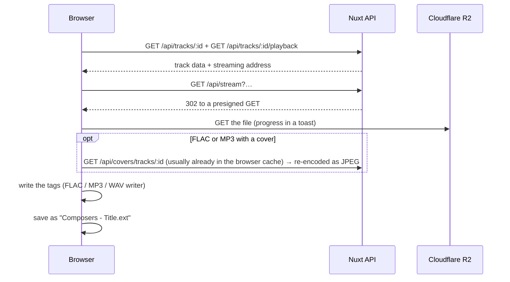

| Stored format | Tags written | Fields |
|---|---|---|
| FLAC (every converted WAV) | Vorbis comments + PICTURE block (`flac-tags.ts`) | title, artist, composer, album, date, genre, comment, lyrics, synced lyrics, front cover |
| MP3 | ID3v2.3 (`id3-tags.ts`, browser-id3-writer); an old ID3v1 tag is removed | the same |
| WAV (float masters kept as WAV) | RIFF LIST/INFO (`wav-tags.ts`) | title, artist, album, year, genre, comment — WAV has no standard place for a cover or lyrics; text is Latin-1, other characters become `?` |
| OGG/Opus, M4A/AAC, WebM | none: saved as stored | — |

- **The audio is never touched:** only the metadata part of the file is rebuilt (FLAC metadata blocks, the ID3 tag, the INFO chunk). Tags already in the file are replaced, not duplicated. The unit tests read every written file back with music-metadata and compare the audio bytes.
- **What is written** is the saved data (unsaved edits are not): composers become both *artist* and *composer*, the description becomes the *comment*, lyrics keep their `[Section]` headers. The Suno prompt and the mastering status are personal notes and never leave the app.
- **Synced lyrics:** in FLAC, `LYRICS` holds them as LRC text (the common convention: players that support it show them in sync) and `UNSYNCEDLYRICS` keeps the plain text; in MP3, the standard `SYLT` frame (times in ms) sits next to the plain `USLT` lyrics. Uploading such a file reads them back.
- **The cover** is stored as WebP, which many players do not show inside a tag: it is re-encoded as JPEG for the file. A cover that cannot be read only means a file without cover, never a failed download.
- **File name:** `Composers - Title.ext` (or `Title.ext`), with the characters Windows, macOS or Linux refuse replaced by `_`, at most 150 characters.
- **On a share page** (only for tracks marked `downloadable`: not public, [7.14](#714-sharing)) the track data is already on the page (genre by name, a signed cover URL), so only the streaming address is asked for, through the same route the page's player uses: `/api/shared/:id/playback`, or `/api/shared/playlists/:id/tracks/:trackId/playback` on a playlist. The file's type comes from `fileExtension`, the one part of the storage key the shared data carries (the key itself names the owner's account). Nothing of the owner's API is called (`/api/tracks`, `/api/genres`).
- **Feedback:** when a download takes more than about 0.7 s, a neutral toast with a spinner shows the progress (a fast download would only flash it, which looks like an error); at the end a toast lists exactly which fields were written.

## 7.12 Storage clean-up

An **orphan** is a file in the user's storage folders that no track or playlist uses: an upload interrupted between the transfer and the registration, or a best-effort deletion that failed. The **Storage** dialog (account menu, `StorageDialog.vue`) finds and removes them.

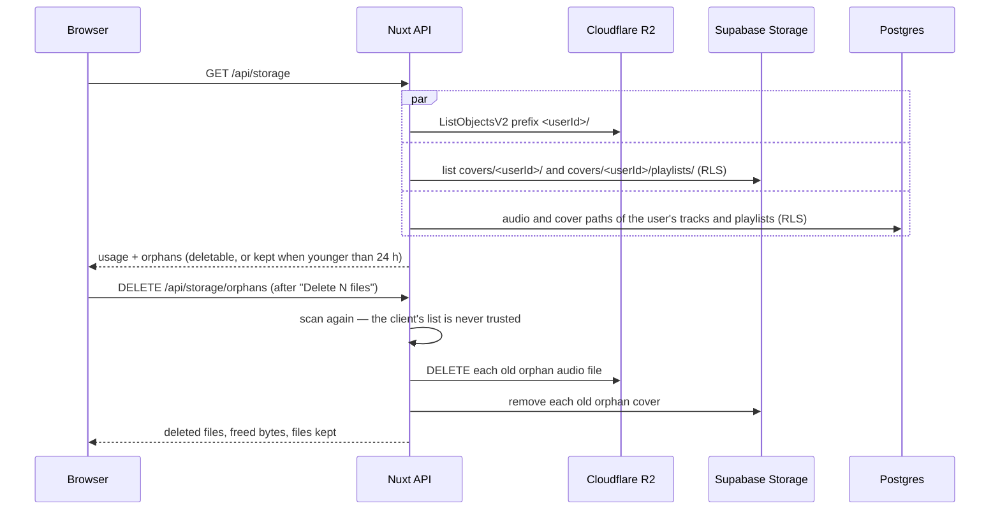

- **Only the user's own folders**, read with the user's own rights: the R2 listing is limited to the `<userId>/` prefix, and Supabase Storage and the database apply RLS. No admin key is involved, so it works the same in production.
- **Never a file in use:** the server compares against the paths of the user's tracks and playlist covers right before deleting.
- **Never an upload in progress:** orphans younger than 24 hours are listed as "Kept for now" (configurable, see [10.1](10-configuration.md#101-environment-variables)). Only a number sets it: a variable left empty, or holding anything else, keeps the 24 hours (`parseMinAgeHours`; an empty one used to mean 0, every orphan deletable at once, the file of an upload still running in another tab included).
- The dialog also shows the space used: audio (R2) and covers, with file counts.
- The clean-up runs when you ask for it; nothing runs on a schedule.

## 7.13 Playlists

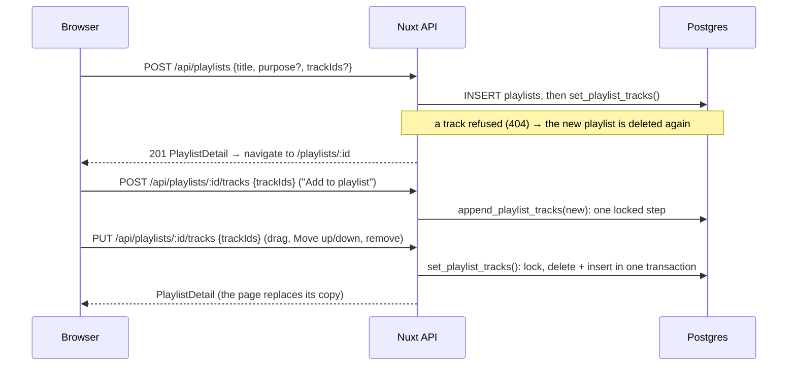

- **Creating:** from the Playlists page, or from a track's menu → "Add to playlist" → "New playlist…" (the playlist starts with that track). The dialog (`PlaylistCreateDialog.vue`) lives in the layout, so any page can open it.
- **Adding:** "Add to playlist" → a playlist appends the track; a track already there keeps its place ("Already in …").
- **Reordering and removing** save immediately (`PUT …/tracks` with the full ordered list). The page updates optimistically and rolls back if the request fails. **One save at a time**: a change made while a save runs waits for it and then goes (only the latest such change, since each carries the whole list), so two quick reorders reach the server in the order they were made and the older list never overwrites the newer one. Drag uses SortableJS through a handle (works with touch; `useSortableList` and `<DragHandle>`, shared with the "Up next" panel); Move up/down is the keyboard-friendly alternative.
- **Atomic order.** `set_playlist_tracks()` deletes and re-inserts every row in one database transaction, running with the caller's rights: a playlist or a track that is not the caller's is "not found" (404), and a list past 1000 tracks fails as a whole (the table's own limit, [8.5](08-data-model-and-security.md#85-security-guarantees)). Entries are never updated in place: a reorder rewrites the list. Its tracks are locked first (`for key share`), so deleting one of them at the same moment (another tab) waits for the rewrite instead of deadlocking with it (a `500`); a track deleted just before is "not found" (404). Appending is one step in the database too (`append_playlist_tracks()`: at the end, in order, skipping tracks already there), not a read followed by a rewrite. Both lock the playlist's row first, so writes to the same playlist at the same moment run one after the other: two appends both land, and two replacements never clash (they used to lose a track, or fail with `409`).
- **Covers.** A custom cover goes through the same crop editor as track covers, and is uploaded to `covers/<userId>/playlists/<playlistId>.webp`. Without one, the UI shows a **mosaic**: the server lists the cover addresses of the first 4 tracks that have one (the same cached `/api/covers/tracks/…` images as the library); 4 covers make a 2×2 grid, fewer show the first alone (`PlaylistCover.vue`).
- **Play all** queues the playlist's tracks in order in the normal player. The store remembers where a queue was started from (`queueFrom`: `playlist:<id>`, or nothing for the library), so the button turns into Pause only while **this playlist** plays, and a row's highlight and its click (pause/resume) follow the same rule: one of its tracks playing from the library used to make "Play all" pause the library instead of starting the playlist. Without a page name (the library, a track's editor) a click on the track playing toggles it whatever its queue.
- **Editing.** The playlist page loads with `GET /api/playlists/:id` and saves with `PATCH /api/playlists/:id` (title, description, visibility, cover), through the same `useEditForm` and `useCoverEditor` as the track editor. Title, description and visibility are edited in a dialog, "Edit details" (`PlaylistDetailsDialog`): each opening starts from the saved values, Cancel drops what was typed, a successful save closes it and hands the saved playlist back to the page; `coverPath: null` removes the custom cover and deletes its file.
- **Deleting** a playlist (`DELETE /api/playlists/:id`) removes it and its custom cover; its tracks stay in the library.
- **Two purposes.** Everything above also serves the groups of versions made by "Share for feedback" (`purpose: 'versions'`): they are listed on their own Versions page and left out of the Playlists page and the "Add to playlist" menus ([7.17](#717-draft-versions-and-feedback)).

## 7.14 Sharing

| Visibility | Who can listen | Who can download (share pages) | Share page |
|---|---|---|---|
| `private` | Only the owner | Visitors of a shared playlist holding it, there only | None: the link answers `404`, exactly like a missing item |
| `unlisted` | Anyone with the link | Anyone with the link | `noindex`: kept out of search engines |
| `public` | Anyone with the link | Nobody (the owner from the library) | Can be indexed by search engines |

There is no public catalog: other people reach an item only through its link (`/t/<track id>` or `/p/<playlist id>`); ids are random UUIDs, so links cannot be guessed. The share boxes and "Copy share link" use the **saved** visibility: a change applies once saved.

**Share sheet on touch screens** (`useShareLink().shareLink`): on a touch screen whose browser has the Web Share API (Android, iPhone, iPad) the button and the menu item read "Share link" and open the device's share sheet with the title and the link; with a mouse they copy the link as before (desktop share sheets are rarely what anyone wants). Closing the sheet does nothing; a refused sheet (e.g. "Share for feedback", where the request to create the group can take long enough after the tap for the browser to refuse) falls back to copying. The choice is made after mount, so the server-rendered page and the first client render agree.

**A shared track** (`pages/t/[id].vue`):

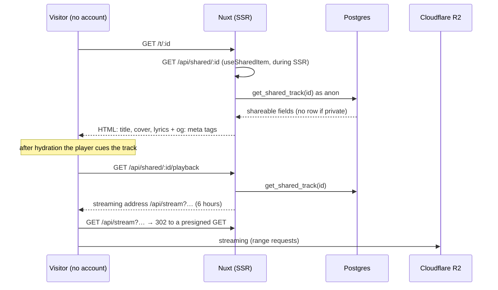

**A shared playlist** (`pages/p/[id].vue`) works the same way through `get_shared_playlist(id)` and `get_shared_playlist_tracks(id)`. The first track is cued on load; the page shows the list, the waveform and, beside them, the lyrics and description of the track being played: the queue's track (`displayTrack`), so a track chosen shows at once, while it loads and after it failed, and a click on any row goes through the store (`playSharedPlaylist`), which toggles the track it is on and starts any other. After a failed track the big Play tries that track again (it used to start the playlist over). The lyrics read the player's position inside `ShareLyrics` (also on `/t/…`): read in the page's template, it made the whole page, up to 1000 rows, render again on every animation frame while the music played. Audio comes from `GET /api/shared/playlists/:id/tracks/:trackId/playback`, which signs **only tracks that belong to that shared playlist**. It reads that one file's path (`get_shared_playlist_track_audio`), and the cover route the one cover it needs (`get_shared_playlist_cover`): both used to read the whole list, lyrics, synced lyrics and peaks included (up to ~11 KB per track), at every change of track.

- **Only shareable fields leave the database.** Other people cannot read the `tracks` or `playlists` tables at all. The `get_shared_*` functions (security definer) return title, composers, album, year, genre name, description, lyrics, peaks and duration — never the Suno prompt, the mastering status or the owner's account (checked by pgTAP tests). The storage keys of the files (`audio_path`, `cover_path`) do come back, since the server needs them to sign the files: they start with the owner's user id, and a key alone opens nothing (both stores are private, every file is reached through a signature, and a row can only name its own files, [8.5](08-data-model-and-security.md#85-security-guarantees)). Nor can the keys be listed: someone else's shared files are signed by their exact name only, so Storage's list endpoint, called with the public key, names neither a user's folder nor the ids inside it.
- **Downloads.** Both pages offer the file with its tags, as the owner's download ([7.11](#711-downloading-a-track)): **Download** under the track page's player, a download button on each row of a playlist. **The track's own visibility decides**, not the playlist's: an unlisted track, or a private one inside a shared playlist, can be downloaded; a **public track never**, on its page or in any playlist. The server sends the outcome (`downloadable`), never the visibility of a playlist's tracks (`get_shared_playlist_tracks` returns it since `20261106000000_shared_track_downloads.sql`). It is a choice of what the page offers, not a lock: the streaming address the player gets is the whole file, so a determined visitor of a public track could still save the stream (untagged). Making the item private stops new downloads like it stops listening.
- **Private tracks inside a shared playlist** can be heard and downloaded through that playlist only: their own `/t/` link still answers `404`, and their audio is signed only via the playlist's id. The playlist editor warns how many private tracks are included.
- **Link previews.** The pages set `og:title`, `og:description`, `og:image` and `robots`. The image points to `/api/shared/…/cover`, a stable address that redirects to a fresh signed URL (previews are cached for a long time; signed URLs expire). A playlist without a custom cover uses its first track cover. An item with no cover at all, or a link no longer available, shows the Chronovault artwork (`/cover-fallback.jpg`, a static JPEG), and `og:site_name` is "Chronovault".
- **Revoking.** Making an item private closes its page immediately (the next request answers `404`); an audio URL already handed out keeps working until it expires, at most 6 hours.
- **The share pages' player** (`<SharePlayer>`): the public layout has no player bar, so each page brings its own controls: play/pause and the waveform; under them previous / next (playlists), the volume (`PlayerVolume`: mute only on touch screens) and **Full screen**, which opens the app's full-screen view (`PlayerExpanded`, mounted by the public layout with `shared`: no "Edit track", no Up next, for a track without lyrics "No lyrics" without the owner's hint to add some (`LyricsView`'s `shared`), the genre read from the shared track, and no request for the owner's genre list). While the page's player is scrolled out of view, **`<ShareMiniPlayer>`** slides up at the bottom of the screen, like the app's phone bar: a progress line, cover and title (tap for the full-screen view; on touch screens swipe left / right / up for next, previous, full screen), previous / play / next. The layout keeps room for it at the bottom (`has-mini-player`). The lock-screen card and media keys work here too.
- **Leaving a public page** stops its music: it is the only place that controls it. Turning the screen off does not: playback goes on, from one track to the next.
- **One implementation for both pages.** `useSharedItem` loads the item during SSR and sets the `404`/`500` status, `useShareMeta` writes the preview tags, `<SharePlayer>` (with `<ShareMiniPlayer>`) and `<ShareUnavailable>` render the player and the "not available" state. On the server, `toSharedTrackContent` builds the shareable fields of a shared track and of every track of a shared playlist, and `playbackSource` (`server/services/playback.ts`) builds their streaming addresses.

## 7.15 Where each piece of data lives

| Data | Stored in | Who reads it |
|---|---|---|
| Accounts, sessions | Supabase Auth | Supabase; the session JWT in browser cookies |
| Track metadata, lyrics, peaks, visibility | Postgres `tracks` | Owner (RLS); shareable fields via `get_shared_*` |
| Genres | Postgres `genres` (built-in + custom) | Everyone (built-in), owner (custom) |
| Playlists, groups of versions and their order | Postgres `playlists` (`purpose` tells them apart), `playlist_tracks` | Owner (RLS); shared ones via `get_shared_playlist*` |
| Audio files | Cloudflare R2 (`<userId>/<trackId>.<ext>`) | Anyone holding a streaming address or the presigned URL it redirects to, both issued by the server and expiring |
| Covers | Supabase Storage `covers` (private) | The owner, through `/api/covers/…` (and a copy in their browser cache); visitors of shared pages, through signed URLs issued under the storage policies |
| Volume | Browser `localStorage` (`chronovault:volume`, like every key of the app: `lib/storage-keys.ts`; keys saved under the former `chronoplayer:` names are moved there on the first visit) | That browser only; used with a mouse or trackpad only (touch screens play at full level) |
| Lyrics view on or off (phones' full-screen player) | Browser `localStorage` (`chronovault:lyrics-view`) | That browser only |
| Play queue (track ids, current track, position) | Browser `localStorage` (`chronovault:queue`) | That browser, for the signed-in user only |
| Shuffle and repeat | Browser `localStorage` (`chronovault:playback-modes`) | That browser only |
| Listener id (a random id, for plays and votes) | Browser `localStorage` (`chronovault:listener-id`) | Sent with plays and votes; identifies nothing but the browser |
| Visits to the share pages | Vercel Web Analytics (aggregated, no cookies) | The owner, through `/api/analytics` (the server holds the Vercel token) |
| R2 credentials, Vercel token | Server environment only | The server |

## 7.16 Statistics

**Counting** happens on the deployed site only (`plugins/web-analytics.client.ts`):

- `@vercel/analytics` loads Vercel's script from `/_vercel/insights`, which exists only on Vercel deployments: the plugin runs only when `public.webAnalytics` is true, i.e. the build ran on Vercel (`VERCEL=1`).
- Its `beforeSend` hook drops every event except the **share pages** (`/t/<id>`, `/p/<id>`, `lib/web-analytics.ts`) and every visit by a **signed-in** user: the owner opening their own link does not count, and private app pages do not use up the plan's allowance.
- No cookies; Vercel counts unique visitors with a hash that changes every day. Vercel cannot count plays (custom events are not part of its Hobby plan): the app counts them itself, see **Plays** below.

**Reading** (`GET /api/analytics?days=7|30`, `analytics.service.ts`):

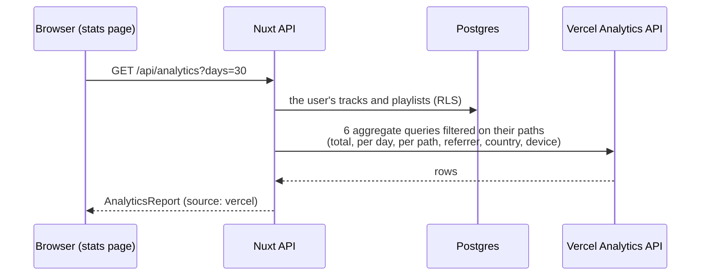

- **Only the user's pages:** Vercel counts the whole site, so every query is filtered on `environment eq 'production' and requestPath in ('/t/…', '/p/…')`, with the paths of **all** the user's tracks and playlists (a page made private again keeps its past visits). The filter is limited to 2048 characters, so paths go in groups of 40 and the groups' results are summed (unique visitors of different groups can then count twice).
- The **token** stays on the server (`runtimeConfig.analytics`); the browser only sees the report. Vercel errors become a `502` with a readable message (`refused the access token: check NUXT_ANALYTICS_TOKEN`), never the token.
- **Where the numbers come from** (`server/utils/web-analytics.ts`, the report's `source`):

| Situation | `source` | The page shows |
|---|---|---|
| Token and project id configured | `vercel` | Real data |
| Not on Vercel (local, Docker, e2e) and not configured | `demo` | **Made-up numbers** around your real tracks and playlists, deterministic, under a yellow "Demo data" banner |
| On Vercel without token or project id | `unconfigured` | How to configure it ([13.6](13-deployment.md#136-statistics-vercel-web-analytics)); never demo data, which could be mistaken for real |

- The page lists every shared item (even without visits) and every item visited in the period; "Private now" marks a page no longer shared.

**Plays** are counted by the app itself (table `plays`), so they are real everywhere, local development included, and visitors with an ad blocker count too:

- **When:** `plugins/play-counter.client.ts` follows the player's position and asks `lib/play-tracker.ts` how much has really been listened to: only the position moving forward a little at a time while playing at normal speed. A seek, a pause or the slowed-down playback of the lyrics sync editor adds nothing. A **play** is 30 seconds, or half of a shorter track; it is **completed** at 90%. Each listen is measured on its own: the count starts again on a new track, on another context, and when the same track **starts over** (repeat one, "repeat all" on a single track, or play pressed after it ended: the player's `listen`). A replay chosen again is a listen again; the server then decides what it adds (one row per listener, track, context and day: the same day it can only mark the play completed, another day it is a new play). The plugin then sends `POST /api/plays` (again with `completed` at 90%); a failed report is simply lost.
- **Where:** every player counts. On the share pages the context is the track's own page or the shared playlist the track is heard through (`playlistId`); in the library the plays are the owner's own.
- **Who:** `record_play` (SQL, `security definer`) recognises the **owner by the session**, never by what the browser says, and stores their plays as `owner` plays, shown apart ("Your own plays"). Anyone else is a `visitor`, identified only by a random id kept in their browser (`lib/listener-id.ts`, also used for votes): one play per listener, track, context and UTC day (replaying the same day only marks the play completed). The function accepts a play only where the caller can listen: a non-private track on its own page, a track inside a non-private playlist through that playlist, or the caller's own track; anything else answers like a missing track (`404`). **At most 100 different visitors per track and UTC day** are counted, whatever the context: a 101st new browser id gets `429` (the player ignores it, the listener notices nothing), while a visitor already counted today still marks the play completed. **The cap counts people, not plays:** a friend who replays a track for hours takes one place the first time and is never refused again that day, even once the 100 places are taken (their replays were one play anyway: one row per listener, track, context and day). And no cap ever stops the music: past it, playback goes on and only the counting stops. The day is UTC (it turns at 1 or 2 am in Italy). Your own plays are never capped. The cap is there for scripts making up a new id per request, not for friends ([8.5](08-data-model-and-security.md#85-security-guarantees)).
- **Reading** (`GET /api/analytics/plays?days=7|30`, `plays.service.ts`): the period's plays of the user's tracks (RLS: owner only, read 1000 rows at a time since PostgREST cuts longer results), summed in total, per day and per share page (`/t/<id>` or `/p/<id>`, the same key as Vercel's items, so the page joins both lists). Plays heard through a playlist deleted since still count in the totals.
- **The page** shows both: tiles (views, visitors, pages visited · plays, listeners, your own plays), **one chart each** for views and plays per day (different scales, never one shared axis: `StatsDailyChart` takes any one number per day), and every shared page with its views and its plays (how many to the end). Without Vercel's numbers (`unconfigured`), the plays are still there.

## 7.17 Draft versions and feedback

A track is a **draft** (a work in progress) or **final** (`tracks.status`, enum `track_status`). New uploads start as drafts (the column default); tracks that existed before the feature became final.

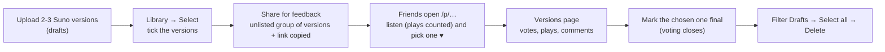

- **Marking:** "Mark as final / Mark as draft" in the track menu (library or group of versions), the *Version* switch on the edit page, or *Mark final* on a selection. Each is a `PATCH /api/tracks/:id { status }`; a selection sends one request per track, in parallel, and reports partial failures.
- **Selection mode** (`pages/index.vue`, `TrackList.vue` with `selectable`): checkboxes on every row; a click on a title ticks it instead of playing, while the cover still plays, so versions can be compared while choosing. Only visible tracks stay selected (changing a filter unticks the hidden ones), so an action never touches what is not on screen. The bar stays under the header while scrolling; on phones it sits at the bottom of the screen, its actions an icon over a short name. On touch screens a **long press** on a row (`useLongPress`, one set of pointer listeners on the list, so the rows the virtual list draws and drops need none) turns the mode on with that track ticked and a short vibration: a touch held 450 ms without moving more than 10 px; moving, or the browser taking the touch over to scroll, drops it. The click that follows the finger's release is swallowed (it ticked the track and then unticked it at once), and while a finger is down the browser's own long-press menu and text selection stay away; the row's checkbox and "⋮" menu keep their own taps. A mouse is unaffected. The ✕ that leads the bar ends the mode, within reach on phones where "Done", at the top of the page, is not once the list is scrolled.
- **Share for feedback:** one `POST /api/playlists` with `purpose: 'versions'`, `visibility: 'unlisted'` and the ticked tracks, titled after their common name (`lib/feedback-playlist.ts`: "Night drive v1" + "Night drive v2" → "Night drive – versions"), then its link is copied. Like any shared playlist, it shares its private tracks inside the group only ([7.14](#714-sharing)).
- **Groups of versions are playlists with another purpose** (`playlists.purpose`, enum `playlist_purpose`): same tables, RLS, share links, storage rules and editor, so nothing about sharing had to be written twice. Only where they appear differs: `GET /api/playlists?purpose=versions` feeds the **Versions** page (`pages/versions/`), while the Playlists page and every "Add to playlist" menu ask for `purpose=playlist` (the default). The purpose is set at creation and never changes. Each purpose has its own cached list (`usePlaylistList(purpose)`); an old `/playlists/:id` link of a group moves to `/versions/:id`.
- **The group's page** (`PlaylistEditor` with `purpose="versions"`) is the playlist editor worded for versions, with a **Final** badge on the chosen one and "Mark as final / draft" in each version's menu. The public page says "Versions · 3 versions" instead of "Playlist · 3 tracks" and, without a description, asks the listener to pick a favourite.
- **Share pages:** `get_shared_track` and `get_shared_playlist_tracks` return the status; drafts show **Work in progress** on `/t/…`, and **WIP** in the list and "Work in progress" in the now-playing header on `/p/…`.
- **Votes** (table `version_votes`): on a group's public page each version has a **heart**; a friend picks one (tapping it again takes the pick back) and can add a **name** and a **comment** for the owner (a note typed and not saved yet stays when they pick another version: only the fields still showing the saved note follow the new pick). One pick per browser and group (the random id of `lib/listener-id.ts`), changeable at will. Nobody sees anyone else's pick; the owner opening their own group gets a note instead of the hearts (the API refuses an owner's vote with `403`). Everything goes through `PUT`, `DELETE` and `GET /api/shared/playlists/:id/vote` (with the browser's id; `useVersionVote` on the page), which call `cast_version_vote`, `withdraw_version_vote` and `get_version_vote` (SQL, `security definer`): the group must be shared and the version must belong to it. **A group takes at most 50 votes** (`MAX_GROUP_VOTES`): a 51st new voter gets `429` and a toast "This group is full", while voters already in can still change or take back their pick (taking one back frees its place).
- **Voting closes** as soon as a version of the group is **final** (`409` from then on, and the public page shows which one was chosen, with a **Chosen** badge); marking it draft again reopens it. A pick of a version since removed from the group stops counting.
- **Feedback on the Versions page** (`GET /api/playlists/:id/feedback`, `PlaylistVersionFeedback.vue`): whether voting is open, votes and listeners in total, one row per version with its votes as a bar and its plays heard through the group's link (visitors only), and the picks that came with a name or a comment, most recent first. Each version's row in the list also shows its votes and plays. Marking a version final or removing one reloads it.
- **New feedback** (table `feedback_seen`, `useUnseenFeedback`; on the group's page `useVersionFeedback`): a vote cast or changed (comment included) after the owner's last visit to its group is **new**. `GET /api/feedback/unseen` counts the new votes per group; the header shows a **dot on "Versions"** while there are any (checked again whenever the app comes back to the screen) and the Versions page a **"N new" badge** on each such card. Inside the group, the panel says "N new votes since your last visit" and marks the new comments. Opening a group clears its badge and its share of the dot at once; the **visit is recorded when the owner leaves** (another page, the tab hidden or closed: `POST /api/playlists/:id/feedback/seen`, sent with `keepalive`), so the new marks last the whole visit even when the feedback reloads. It is recorded up to when the feedback on screen was read (`asOf`), not up to "now": a vote that arrives while the owner looks at an older copy stays new. The server never records a time in the future, nor moves a visit back (a later one from another device is kept). The visit is stored on the server, in a table of its own rather than in `playlists` (a playlist update moves its `updated_at`, which versions its cover addresses): the same on every device. A group never visited since the feature counts from its creation. Plays are not "new feedback": only votes and comments are.
- **Statistics** count a group's link like any playlist link (`/p/…`), its plays included.
- **Bulk delete:** one `DELETE` per ticked track, in parallel, after one confirmation listing them; tracks that fail stay selected for a retry. The deleted ones leave the library and the play queue in one pass each (`removeTracks`, with a set of ids): looking every track up in a list cost millions of comparisons for a few thousand tracks. Deleting the track playing, or the one the queue is moving to while it loads, closes the player.

---

← [6. Project structure](06-project-structure.md) · [Contents](../README.md#documentation) · [8. Data model and security](08-data-model-and-security.md) →
