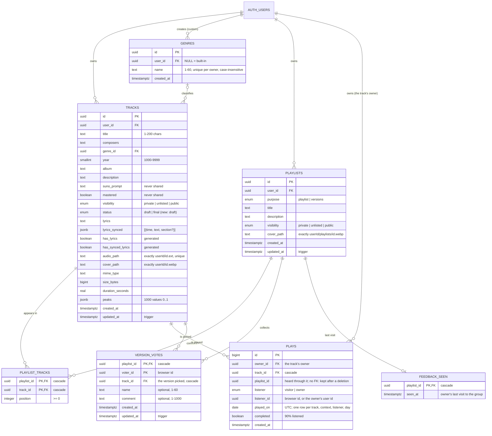

# 8. Data model and security

## 8.1 Entities

Constraints worth knowing: file paths are exactly the ones the app builds (`<owner>/<track id>.<ext>`, `<owner>/<track id>.webp`, `<owner>/playlists/<playlist id>.webp`); the owner of a track or playlist can never change (trigger); a track appears at most once per playlist; a listener counts once per track, context and day; a browser has one vote per group; deleting a user deletes everything they own.

## 8.2 Migrations

Applied in order from `supabase/migrations/`. An applied migration's statements are never edited: later migrations alter what earlier ones created.

| File | Content |
|---|---|
| `20261018000000_schema.sql` | Visibility enum; `genres` and `tracks`; constraints, indexes, `updated_at` and owner-change triggers; 26 built-in genres |
| `20261018000100_rls.sql` | RLS on `genres` and `tracks`; first version of `get_shared_track` |
| `20261018000200_storage.sql` | Private buckets `covers` (10 MB, images) and `audio` (500 MB, used locally only); storage policies; `is_shared_track_file` |
| `20261020000000_grants.sql` | Explicit table privileges for `anon` and `authenticated` (independent of the project's default grants) |
| `20261021000000_public_sharing.sql` | `tracks` becomes owner-only; `get_shared_track` returns shareable fields only |
| `20261022000000_playlists.sql` | `playlists`, `playlist_tracks`, their RLS; `set_playlist_tracks`; `get_shared_playlist(_tracks)`; storage sharing extended to playlists |
| `20261023000000_track_status.sql` | `tracks.status` (`draft` / `final`: existing tracks final, new ones draft); the sharing functions return it |
| `20261024000000_playlist_purpose.sql` | `playlists.purpose` (`playlist` / `versions`; existing unlisted "… – versions" playlists become groups); index by purpose; `get_shared_playlist` returns it |
| `20261024120000_plays_and_votes.sql` | `plays` and `version_votes`, readable by the owner only; `record_play`, `cast_version_vote`, `withdraw_version_vote`, `get_version_vote` and their internal helpers (revoked from `anon` and `authenticated` explicitly) |
| `20261024130000_private_helpers.sql` | Internal functions out of the API: the policy helpers `is_shared_track_file` and `owns_playlist` move to the unexposed `private` schema (`set_playlist_tracks` recreated to call the latter there), `set_playlist_tracks` for signed-in users only, the trigger functions callable by nobody |
| `20261025000000_feedback_seen.sql` | `feedback_seen`: the owner's last visit to each group of versions (new feedback), owner only |
| `20261026000000_anonymous_write_caps.sql` | Caps on anonymous writes: `record_play` counts at most 100 different visitors per track and day, `cast_version_vote` takes at most 50 votes per group; past them `53400` (→ `429`). Index on a track's visitors per day |
| `20261026120000_storage_path_rules.sql` | Storage paths are exactly the ones the app builds: `tracks.audio_path` `<user_id>/<id>.<extension>`, `tracks.cover_path` `<user_id>/<id>.webp`, `playlists.cover_path` `<user_id>/playlists/<id>.webp` (they only had to start with the owner's folder, so a `..` could name another user's file) |
| `20261027000000_playlist_track_writes.sql` | Writes to a playlist's list that overlap: `set_playlist_tracks` locks the playlist's row first (two replacements at once clashed with `23505`), and the new `append_playlist_tracks` appends in one locked step (an append was a read and a rewrite, so two at once lost a track) |
| `20261027120000_shared_playlist_lookups.sql` | `get_shared_playlist_track_audio` and `get_shared_playlist_cover`: one path each, where the shared playlist's playback and cover routes read the whole list |
| `20261027130000_lookup_indexes.sql` | Indexes on `tracks.cover_path` and `playlists.cover_path` (the storage policy looked covers up with a scan of every user's rows, once per cover signed) and on `genres.user_id` |
| `20261027140000_playlist_track_ownership.sql` | `set_playlist_tracks` and `append_playlist_tracks` check the track ids first: one that is not the caller's is "not found" (`P0002`, 404, like any other item) instead of the policy's `42501` (403) as the row went in |
| `20261028000000_playlist_track_rules.sql` | Playlist entries can no longer be updated directly (privilege and policy dropped: the update policy checked the playlist, not the track, so an entry could be pointed at another user's track and shared); the 1000-track limit becomes a trigger on `playlist_tracks`, holding for every insert (`set_playlist_tracks` and direct writes had none), and `append_playlist_tracks` drops its own check |
| `20261028120000_storage_sign_only.sql` | Someone else's shared files can be **signed by name only, never listed**: the read policy's shared branch now holds for the `object.sign` and `object.sign_many` operations alone (`storage.allow_any_operation`). With the public key, Storage's list endpoint used to name every user's folder and every shared cover in it, so the id of every unlisted track and playlist with a cover |
| `20261028180000_track_genre_and_lock_order.sql` | A track's genre must be built-in or its owner's own (trigger `tracks_check_genre`; any other id answers like a missing one, `23503`, 400): the tracks policies check the owner only, and the foreign key ignores RLS, so another user's private genre could be set on one's own track and showed on its share page. `set_playlist_tracks` and `append_playlist_tracks` lock the tracks they will hold (`for key share`) before writing, and count them: a reorder and the deletion of one of its tracks used to deadlock (`40P01`, 500), and a track deleted meanwhile is now "not found" (404) |
| `20261106000000_shared_track_downloads.sql` | `get_shared_playlist_tracks` also returns each track's `visibility`, so the server can tell which tracks visitors may download (not public ones); the API sends only that outcome (`downloadable`), never the visibility itself |

## 8.3 Database functions

| Function | Security | Purpose |
|---|---|---|
| `get_shared_track(id)` | definer | Shareable fields of a non-private track (nothing for private ones) |
| `get_shared_playlist(id)` | definer | A non-private playlist's title, description, cover, visibility, purpose |
| `get_shared_playlist_track_audio(id, track)` · `get_shared_playlist_cover(id)` | definer | One path each, for the share page's player and link previews: the audio file of a track of a non-private playlist (null otherwise), and the cover it shows (its own, else the first track cover) |
| `get_shared_playlist_tracks(id)` | definer | Shareable fields of every track of a non-private playlist, in order (private tracks included), with each track's visibility for the download rule |
| `private.is_shared_track_file(bucket, path)` | definer | Storage policy helper: the file belongs to a non-private track, to a track in a non-private playlist, or is a non-private playlist's cover |
| `set_playlist_tracks(id, ids[])` | invoker | Replaces a playlist's tracks in one transaction, the playlist's row locked first, then the tracks it will hold (`for key share`, so none is deleted meanwhile: a reorder and a deletion at once used to deadlock) (RLS applies); a track that is not the caller's (missing, someone else's or deleted meanwhile) is `P0002` (404), nothing written; signed-in users only |
| `append_playlist_tracks(id, ids[])` | invoker | Appends tracks at the end, in order, skipping those already there, in one locked step, its tracks locked like `set_playlist_tracks`'s (RLS applies); a track that is not the caller's is `P0002` (404); signed-in users only |
| `private.enforce_playlist_size()` | trigger, invoker | After each insert into `playlist_tracks`: a playlist past 1000 tracks fails the statement (`23514`, 400), whatever wrote it |
| `private.check_track_genre()` | trigger, invoker | Before a track is created or its genre changed: the genre must be built-in or the track owner's own, any other id answering like a missing one (`23503`, 400) |
| `private.owns_playlist(id)` | invoker | RLS helper for `playlist_tracks`, `version_votes` and `feedback_seen`; also the ownership check of `set_playlist_tracks` and `append_playlist_tracks` |
| `record_play(track, playlist, listener, completed)` | definer | Counts a play where the caller can listen (shared track page, shared playlist containing it, own track); the owner, recognised by the session, gets `owner` plays; at most 100 different visitors per track and day (`53400` → `429`) |
| `cast_version_vote(group, track, voter, name, comment)` · `withdraw_version_vote(group, voter)` | definer | A visitor's pick in a shared group of versions: the version must belong to it; `403` for the owner, `409` once a version is final, `429` for a new voter in a group that has 50 votes already |
| `get_version_vote(group, voter)` | definer | Voting open, whether the caller owns the group, and this browser's own pick (never anyone else's) |
| `shared_group_owner(id)` · `version_voting_open(id)` · `check_version_voting(id, voter)` | definer, internal | Helpers of the vote functions; not callable through the API |
| `set_updated_at()` · `prevent_owner_change()` | trigger | Timestamps · immutable owner (no role may call them directly) |

*Security definer* functions bypass RLS, so each one filters on visibility itself and selects explicit columns; all have an empty `search_path`. **What the API offers.** Every function of the `public` schema the caller may execute is callable through the Data API (`POST /rest/v1/rpc/<name>`), and Supabase's default privileges grant `execute` on new functions there to `anon` and `authenticated` explicitly, so `revoke … from public` alone does not hide one. The rules:

- a function meant for the API stays in `public`, granted to the roles that need it (`get_shared_*`, plays, votes: both roles; `set_playlist_tracks` and `append_playlist_tracks`: `authenticated`);
- an internal helper of other functions stays in `public` but is revoked from `anon` and `authenticated` by name (the vote helpers): the definer functions that call it run as its owner;
- a **helper of policies** cannot be revoked, since the policies run as the requesting role and need `execute`: it lives in the **`private` schema**, which the API does not expose (`[api] schemas` in `supabase/config.toml`, the same default on Supabase Cloud), with `usage` granted to the roles whose policies call it. Policies refer to a function by its identity, so moving one keeps them working; function bodies refer to it by name and must be updated.

`function_privileges.test.sql` lists exactly what each role may call in `public`: a new function exposed by mistake fails the tests.

## 8.4 Storage

| Bucket | Where | Content | Access |
|---|---|---|---|
| `covers` | Supabase Storage (private) | `<userId>/<trackId>.webp`, `<userId>/playlists/<playlistId>.webp` | Write: own folder only. Read: own files (any operation, list included), or files of shared items, to sign them by name only (never listed) |
| `chronovault-audio` | Cloudflare R2 (private) | `<userId>/<trackId>.<ext>` | Only through streaming addresses and presigned URLs issued by the server |
| `audio` | Local Supabase only | Same layout as R2 | Stand-in for R2 in development (S3 protocol) |

## 8.5 Security guarantees

Verified by the pgTAP tests (`supabase/tests/database/`), plus unit and end-to-end tests:

- A user reads, changes and deletes only their own tracks, genres and playlists. Nobody can create items for someone else or change an item's owner. **A track's genre is a built-in one or its owner's own** (`20261028180000_track_genre_and_lock_order.sql`): the foreign key alone ignores RLS, and another user's private genre could be set on one's own track, its name then shown on the track's share page; such an id now answers like a missing one, so it tells nothing about what exists.
- Playlists can only contain the owner's own tracks, and at most 1000 of them. Entries are added and removed, never updated (`20261028000000_playlist_track_rules.sql`): the update policy checked only the playlist, so a signed-in user writing straight through the Data API could point an entry of their own playlist at someone else's track (its id was enough) and share it, exposing that track's lyrics, audio and cover. The 1000-track limit is a trigger on the table, so it holds for direct writes too, not only in the app's functions.
- Anonymous visitors cannot read any table but `genres`, and of it only the built-in genres (the ones `/api/keepalive` reads); through the API they can otherwise only call the `get_shared_*` functions, which return nothing for private items and never the Suno prompt, the mastering status or the owner's account (only the storage keys of the files, which start with the owner's id: the server signs files by them), and the plays and votes functions. Internal helpers are not callable at all (checked function by function).
- A private track inside a shared playlist is reachable only through that playlist.
- Plays and votes are written only through their functions, only where the caller can listen or vote; the owner's plays are kept apart by the session, and only the owner reads plays and votes. A visitor sees their own pick, never anyone else's. The owner's visits to their groups (`feedback_seen`) are theirs alone.
- **Anonymous writes are capped** in the database functions themselves (`20261026000000_anonymous_write_caps.sql`): at most 100 different visitors per track and UTC day in `record_play`, at most 50 votes per group in `cast_version_vote`; past them `53400`, answered `429`. A visitor is only a browser id the server cannot check, so without caps a script making up a new id per request could inflate the statistics, flood a group with votes and comments, and grow the tables up to the Free plan's limit (where every write of the app fails). The caps are in SQL, not in the app's server, because `anon` may call these functions straight through the Data API with the public key; and they are per track and per group, not per IP, because requests through the app reach Supabase from the server's address. A transaction-scoped advisory lock per track (per group) keeps parallel requests from all taking the last place.
- Files can be uploaded only into one's own folder, and read only when they are one's own or belong to shared items. **Someone else's shared files are signed by name, never listed** (`20261028120000_storage_sign_only.sql`): Storage tells the database each request's operation (`storage.operation()`), and the policy's shared branch holds for signing only. Before, anyone with the public key, which ships with the site, could list the `covers` bucket: its root named every user with a shared cover, and each folder the ids of their unlisted tracks and playlists (`<id>.webp`), which open their pages. "Unlisted" means whoever was sent the link, and now holds again.
- **An upload address stores one file only:** its signature holds the declared size and type (`AudioStorage.presign`, `allHeaders`), so the storage refuses any other PUT (`403`). Unsigned, the 500 MB limit held only when the track was registered, and anyone signed in could fill the storage with files never registered. `pnpm r2:check` checks that R2 refuses a file of another size.
- **No text reaches the database with a NUL character** (U+0000), which Postgres cannot store in text or jsonb: every free text of the shared schemas refuses it (`safeText`, `400`), a storage path must be exactly the one the server builds (`400` too), and the error codes Postgres would raise (`22P05`, `22021`) map to `400` as a safety net. It used to come back as a `500`, anonymous votes' comments included.
- **A row names only its own files, by the exact paths the app builds** (`20261026120000_storage_path_rules.sql`): `tracks.audio_path` is `<user_id>/<id>.<extension>`, `tracks.cover_path` `<user_id>/<id>.webp`, `playlists.cover_path` `<user_id>/playlists/<id>.webp`, enforced by check constraints, since a signed-in user may write their own rows straight through the Data API without the app's server. Before that only the first folder was checked, and a path such as `<own id>/../<other id>/<track>.flac` passed: URL parsing resolves the `..` when the server signs it, so the signature covered another user's file (delete the forged track, and the server deleted the victim's audio). The server also refuses to sign or touch any key with an empty, `.` or `..` segment (`isSafeStorageKey`, `shared/utils/storage-paths.ts`), whatever the database holds.
- Every bucket is private: files are reachable only through expiring signed URLs. The R2 keys exist only on the server.
- The public Supabase key (`SUPABASE_KEY`) can live in the browser: protection comes from the policies, not from hiding the key. The service key is never used.
- API errors never include SQL messages or stack traces (logged server-side only).
- **Security headers** on every response (`routeRules` in `nuxt.config.ts`): `X-Content-Type-Options: nosniff`, `Referrer-Policy: strict-origin-when-cross-origin`, `X-Frame-Options: DENY`, `Strict-Transport-Security` (two years; browsers ignore it over plain HTTP, so localhost and Docker are unaffected) and a `Permissions-Policy` turning off camera, microphone and geolocation. Every `/api/**` answer is also `Cache-Control: no-store`, except the cover images of `/api/covers/**` (a one-year private cache: their addresses change with the cover).
- **Content Security Policy** on every HTML page of a production build (`server/plugins/content-security-policy.ts`, built by `server/utils/content-security-policy.ts`). Scripts run only from the site itself or with the page's **nonce**, drawn for each response and written into the inline scripts Nuxt adds (colour mode, payload); a script slipped in through user content (lyrics, descriptions, comments) would not run. The nonce goes into real `` into a script that carried the nonce and ran. The page may talk only to the site, Supabase and the audio storage, both origins read from the runtime config (so one build fits local, Docker and Vercel), and may show images from Supabase too (the share pages' covers are signed Storage URLs; the owner's pages use the app's own `/api/covers`), and may not be framed by another site (`frame-ancestors 'none'`). No icon or font is fetched from a third party at runtime (icons are bundled or served by the app, fonts are downloaded at build time). Styles allow `'unsafe-inline'` (Vue's style bindings), and `https://www.gstatic.com` is allowed for the Cast SDK of the temporary `/cast-test` page only. The dev server sends no policy: its hot reload injects scripts of its own.

---

← [7. Data flows](07-data-flows.md) · [Contents](../README.md#documentation) · [9. API reference](09-api-reference.md) →
